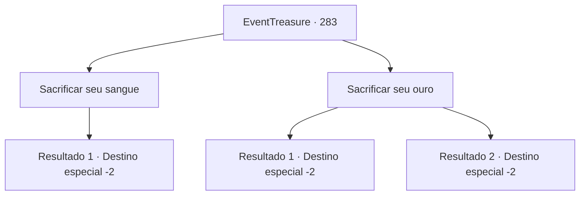

# Eventos de tesouro · 283

[Índice da tabela](index.md) · [Índice geral](../index.md)

ID: `pt:EventTreasure:283` · Fonte: `EventTreasure4` · Versão: 1.2.47.

Mapeamento estático dos arquivos; a disponibilidade e a execução dependem do estado da run.

## Texto do evento

*Sem texto no arquivo.*

## Dados de entrada

```json
{
  "id": 283,
  "grade": 1,
  "place": "",
  "required": ""
}
```

## Mapa das escolhas



## Escolhas e resultados

### Escolha 1

Sacrificar seu sangue

Requisitos e outros campos da escolha:

```json
{
  "required": "1_13_2"
}
```

#### Resultado 1.1

Você decidiu sacrificar seu sangue para obter o poder do demônio. Al Harmutt ouviu sua resposta e trouxe uma adaga de osso. Ele cortou seu braço com a adaga e recolheu o sangue. Em seguida, ele jogou o sangue no fogo. A chama verde de repente se torna roxa e queima intensamente. Você se sente tonto/a e ao mesmo tempo sente uma estranha força fluindo em você. 

 "Parabéns. Parece que o Senhor Grimora está satisfeito com sua oferta. Agora vá."

 Você sai da caverna com o poder de Grimora.

Continuação registrada: [Destino especial `-2`](../destinos-especiais.md).

```json
{
  "required": "",
  "chance": "1",
  "nextEvent": -2,
  "type": 2,
  "reward": "27_37_1|0_13_-1|5_546_9|0_2_1"
}
```

### Escolha 2

Sacrificar seu ouro

Requisitos e outros campos da escolha:

```json
{
  "required": ""
}
```

#### Resultado 2.1

Você decidiu sacrificar seu ouro para obter o poder do demônio. Al Harmutt ouviu sua resposta, pegou seu ouro e o jogou no fogo. A chama verde de repente se torna roxa e queima intensamente. Você sente uma estranha força fluindo em sua direção. 

 "Parabéns. Parece que o Senhor Grimora está satisfeito com sua oferta. Agora vá."

 Você sai da caverna com o poder de Grimora.

Continuação registrada: [Destino especial `-2`](../destinos-especiais.md).

```json
{
  "required": "1_4_200",
  "chance": "1",
  "nextEvent": -2,
  "type": 2,
  "reward": "27_37_1|0_4_-200|5_546_9|0_2_1"
}
```

#### Resultado 2.2

Você decidiu sacrificar seu ouro para obter o poder do demônio. Al Harmutt ouviu sua resposta, pegou seu ouro e o jogou no fogo. A chama verde de repente se torna roxa e queima intensamente. Mas nada mais acontece. 

 "Bem... o Senhor Grimora não aprova sua oferta."

 Você sai da caverna de mãos vazias.

Continuação registrada: [Destino especial `-2`](../destinos-especiais.md).

```json
{
  "required": "2_4_200",
  "chance": "1",
  "nextEvent": -2,
  "type": 2,
  "reward": "0_4_-100|5_546_9"
}
```

## Referências que chegam a este evento

- [Evento 282 · escolha 1 · resultado 1](0282.md#escolha-1)
