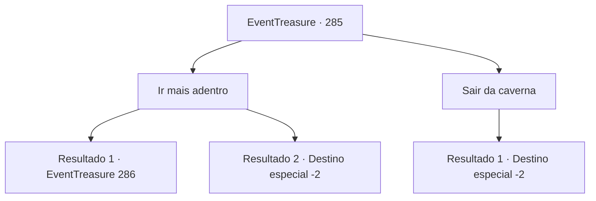

# Eventos de tesouro · 285

[Índice da tabela](index.md) · [Índice geral](../index.md)

ID: `pt:EventTreasure:285` · Fonte: `EventTreasure4` · Versão: 1.2.47.

Mapeamento estático dos arquivos; a disponibilidade e a execução dependem do estado da run.

## Texto do evento

*Sem texto no arquivo.*

## Dados de entrada

```json
{
  "id": 285,
  "grade": 1,
  "place": "",
  "required": ""
}
```

## Mapa das escolhas



## Escolhas e resultados

### Escolha 1

Ir mais adentro

Requisitos e outros campos da escolha:

```json
{
  "required": ""
}
```

#### Resultado 1.1

Você adentrou mais na caverna. A estreita caverna estava cheia de ossos e carne podre, exalando um cheiro fétido. Você tapa o nariz e explora a caverna sinuosa. Finalmente, chega a um espaço ligeiramente maior que o corredor. No meio do espaço, há um altar feito de ossos. Em cima do altar, estão as cabeças dos paladinos. Enquanto você está olhando o altar, algo voa em sua direção.

Continuação registrada: [Evento 286](0286.md) na mesma tabela.

```json
{
  "required": "",
  "chance": "1|0_7_1",
  "nextEvent": 286,
  "type": 0,
  "reward": ""
}
```

#### Resultado 1.2

Você se adentrou mais na caverna. A estreita caverna estava cheia de ossos e carne podre, exalando um cheiro fétido. Você tapa o nariz e explora a caverna sinuosa. Finalmente, você chega ao mesmo lugar onde começou. Você não encontra Al Harmutt, então sai da caverna.

Continuação registrada: [Destino especial `-2`](../destinos-especiais.md).

```json
{
  "required": "",
  "chance": "14",
  "nextEvent": -2,
  "type": 1,
  "reward": "5_546_9"
}
```

### Escolha 2

Sair da caverna

Requisitos e outros campos da escolha:

```json
{
  "required": ""
}
```

#### Resultado 2.1

Você escapou da caverna, cheirando a sangue e corpos em decomposição. Em seguida, você corre em alta velocidade para se livrar do cheiro.

Continuação registrada: [Destino especial `-2`](../destinos-especiais.md).

```json
{
  "required": "",
  "chance": "1",
  "nextEvent": -2,
  "type": 2,
  "reward": "5_546_9"
}
```

## Referências que chegam a este evento

- [Evento 284 · escolha 1 · resultado 1](0284.md#escolha-1)
