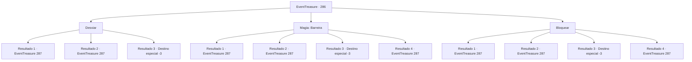

# Eventos de tesouro · 286

[Índice da tabela](index.md) · [Índice geral](../index.md)

ID: `pt:EventTreasure:286` · Fonte: `EventTreasure4` · Versão: 1.2.47.

Mapeamento estático dos arquivos; a disponibilidade e a execução dependem do estado da run.

## Texto do evento

*Sem texto no arquivo.*

## Dados de entrada

```json
{
  "id": 286,
  "grade": 1,
  "place": "",
  "required": ""
}
```

## Mapa das escolhas



## Escolhas e resultados

### Escolha 1

Desviar

Requisitos e outros campos da escolha:

```json
{
  "required": ""
}
```

#### Resultado 1.1

Primeiro você joga seu corpo para o lado, desviando de algo que está voando em sua direção. Passa zunindo ao seu lado, se alojando na parede da caverna com um 'thwack-!' Ao olhar mais de perto, parece ser uma flecha grande feita de vários ossos. 

 "Maldição! Esse bastardo teimoso!"

 O fanático jura enquanto seu ataque não atinge seu objetivo. Em seguida, ele começa a reunir energia escura e se lança em sua direção.

Continuação registrada: [Evento 287](0287.md) na mesma tabela.

```json
{
  "required": "",
  "chance": "1|0_6_1",
  "nextEvent": 287,
  "type": 0,
  "reward": "6_0_71",
  "place": 6
}
```

#### Resultado 1.2

Enquanto você tenta desviar algo que voa em sua direção, sua reação foi tarde demais para evitá-lo. A grande flecha, feita de vários ossos, atravessa sua carne e se aloja na parede da caverna. 

 "Hehe! Você conseguiu não morrer!"

 Imediatamente depois, o fanático que estava se escondendo em algum lugar se apressa em sua direção.

Continuação registrada: [Evento 287](0287.md) na mesma tabela.

```json
{
  "required": "1_0_2",
  "chance": "12",
  "nextEvent": 287,
  "type": 1,
  "reward": "6_0_71|0_0_-1",
  "place": 6
}
```

#### Resultado 1.3

Tentaste desviar algo que voava em tua direção. No entanto, devido à tua reação tardia, não conseguiste evitar. A grande flecha, feita de vários ossos, atravessa o teu peito e te prende na parede da caverna. 

 "Ha ha ha! Bem feito! Perfeito!"

 O fanático, que estava escondido em algum lugar, se aproxima de ti rindo grotescamente. Mas não te resta força para se defender. À medida que o teu corpo esfria gradualmente, os teus olhos se fecham.

Continuação registrada: [Destino especial `-3`](../destinos-especiais.md).

```json
{
  "required": "2_0_2",
  "chance": "12",
  "nextEvent": -3,
  "type": 1,
  "reward": "0_0_-1"
}
```

### Escolha 2

Magia: Barreira

Requisitos e outros campos da escolha:

```json
{
  "required": "20_0_2|1_1_2"
}
```

#### Resultado 2.1

Para começar, você desdobra uma barreira para desviar algo que voa em sua direção. Passa zunindo ao seu lado, se alojando na parede da caverna com um 'thwack-!' Ao olhar mais de perto, parece ser uma flecha grande feita de vários ossos. 

 "Maldição! Esse bastardo teimoso!"

 O fanático jura enquanto seu ataque não atinge seu objetivo. Em seguida, ele começa a reunir energia escura e se lança em sua direção.

Continuação registrada: [Evento 287](0287.md) na mesma tabela.

```json
{
  "required": "21_0_4",
  "chance": "1|0_14_1",
  "nextEvent": 287,
  "type": 0,
  "reward": "6_0_71",
  "place": 6
}
```

#### Resultado 2.2

Tentaste desdobrar uma barreira. Mas a tua reação foi demasiado tarde. A grande flecha, feita de vários ossos, atravessa a tua carne e se incrusta na parede da caverna. 

 "Hehe! Conseguiste não morrer!"

 Imediatamente depois, o fanático que se escondia em algum lugar se apressa em tua direção.

Continuação registrada: [Evento 287](0287.md) na mesma tabela.

```json
{
  "required": "1_0_2|21_0_4",
  "chance": "12",
  "nextEvent": 287,
  "type": 1,
  "reward": "6_0_71|0_0_-1",
  "place": 6
}
```

#### Resultado 2.3

Tentaste desdobrar uma barreira. Mas a tua reação foi tarde demais. A grande flecha, feita de vários ossos, atravessa o teu peito e te prende na parede da caverna. 

 "Ha ha ha! Bem feito! Perfeito!"

 O fanático, que estava escondido em algum lugar, se aproxima de ti rindo grotescamente. Mas não te resta força para te defenderes. À medida que o teu corpo esfria gradualmente, os teus olhos se fecham.

Continuação registrada: [Destino especial `-3`](../destinos-especiais.md).

```json
{
  "required": "2_0_2|21_0_4",
  "chance": "12",
  "nextEvent": -3,
  "type": 1,
  "reward": "0_0_-1"
}
```

#### Resultado 2.4

Para começar, você desdobra uma barreira para desviar algo que voa em sua direção. Passa zunindo ao seu lado, se alojando na parede da caverna com um 'thwack-!' Ao olhar mais de perto, parece ser uma flecha grande feita de vários ossos. 

 "Maldição! Esse bastardo teimoso!"

 O fanático jura enquanto seu ataque não atinge seu objetivo. Em seguida, ele começa a reunir energia escura e se lança em sua direção.

Continuação registrada: [Evento 287](0287.md) na mesma tabela.

```json
{
  "required": "20_0_4",
  "chance": "1",
  "nextEvent": 287,
  "type": 2,
  "reward": "6_0_71",
  "place": 6
}
```

### Escolha 3

Bloquear

Requisitos e outros campos da escolha:

```json
{
  "required": "20_9_1"
}
```

#### Resultado 3.1

Você bloqueou algo que voava em sua direção. Era uma flecha grande feita de vários ossos, que se despedaçou ao te atingir. 

 "Maldição! Esse bastardo teimoso!"

 O fanático jura enquanto seu ataque não atinge seu objetivo. Em seguida, ele começa a reunir energia negra e se lança em sua direção.

Continuação registrada: [Evento 287](0287.md) na mesma tabela.

```json
{
  "required": "21_9_4",
  "chance": "1|0_5_1|0_13_1",
  "nextEvent": 287,
  "type": 0,
  "reward": "6_0_71",
  "place": 6
}
```

#### Resultado 3.2

Tentaste bloquear algo que voava em tua direção, mas em vez disso foste empurrado contra a parede da caverna. A flecha grande, construída de ossos, chocou-se contigo, obrigando-te a bater contra a parede da caverna antes de se despedaçar em fragmentos. 

 "Hehe! Conseguiste não morrer!"

 Imediatamente depois, o fanático que se escondia em algum lugar se apressa em tua direção.

Continuação registrada: [Evento 287](0287.md) na mesma tabela.

```json
{
  "required": "1_0_2|21_9_4",
  "chance": "24",
  "nextEvent": 287,
  "type": 1,
  "reward": "6_0_71|0_0_-1",
  "place": 6
}
```

#### Resultado 3.3

Tentaste desviar algo que voava em tua direção, mas em vez disso, foste empurrado contra a parede da caverna. Como resultado, tua coluna vertebral se fraturou. A grande flecha, construída a partir de uma multidão de ossos, que te impulsionou contra a parede também se quebrou em fragmentos. 

 "Ha ha ha! Bem feito! Perfeito!"

 O fanático, que estava escondido em algum lugar, se aproxima de ti rindo grotescamente. Mas não te resta força para te defender. À medida que teu corpo esfria gradualmente, teus olhos se fecham.

Continuação registrada: [Destino especial `-3`](../destinos-especiais.md).

```json
{
  "required": "2_0_2|21_9_4",
  "chance": "24",
  "nextEvent": -3,
  "type": 1,
  "reward": "0_0_-1"
}
```

#### Resultado 3.4

Você bloqueou algo que voava em sua direção. Era uma flecha grande feita de vários ossos, que se despedaçou ao te atingir. 

 "Maldição! Esse bastardo teimoso!"

 O fanático jura enquanto seu ataque não atinge seu objetivo. Em seguida, ele começa a reunir energia negra e se lança em sua direção.

Continuação registrada: [Evento 287](0287.md) na mesma tabela.

```json
{
  "required": "20_9_4",
  "chance": "1",
  "nextEvent": 287,
  "type": 2,
  "reward": "6_0_71",
  "place": 6
}
```

## Referências que chegam a este evento

- [Evento 285 · escolha 1 · resultado 1](0285.md#escolha-1)
