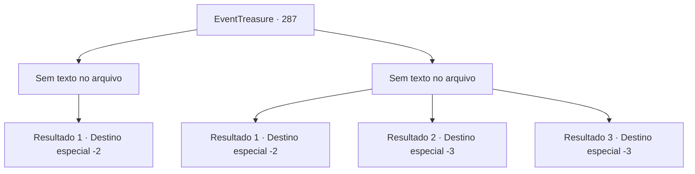

# Eventos de tesouro · 287

[Índice da tabela](index.md) · [Índice geral](../index.md)

ID: `pt:EventTreasure:287` · Fonte: `EventTreasure4` · Versão: 1.2.47.

Mapeamento estático dos arquivos; a disponibilidade e a execução dependem do estado da run.

## Texto do evento

*Sem texto no arquivo.*

## Dados de entrada

```json
{
  "id": 287,
  "grade": 1,
  "place": "",
  "required": ""
}
```

## Mapa das escolhas



## Escolhas e resultados

### Escolha 1

*Sem texto no arquivo; o papel dessa opção depende da interface do jogo.*

Requisitos e outros campos da escolha:

```json
{
  "required": ""
}
```

#### Resultado 1.1

O fanático te atacou com fúria, mas no final, pagou o preço por sua audácia com sua vida. Você revira seu esconderijo, recolhe objetos úteis e então sai da caverna.

Continuação registrada: [Destino especial `-2`](../destinos-especiais.md).

```json
{
  "required": "",
  "chance": "1",
  "nextEvent": -2,
  "type": 2,
  "reward": "5_546_9|0_4_50|3_216_1"
}
```

### Escolha 2

*Sem texto no arquivo; o papel dessa opção depende da interface do jogo.*

Requisitos e outros campos da escolha:

```json
{
  "required": ""
}
```

#### Resultado 2.1

Você esquiva do ataque do louco e corre freneticamente para fora da caverna. Ele te persegue, mas parece cansar e não te persegue mais.

Continuação registrada: [Destino especial `-2`](../destinos-especiais.md).

```json
{
  "required": "1_0_2|1_1_2",
  "chance": "1",
  "nextEvent": -2,
  "type": 2,
  "reward": "5_546_9|0_0_-1|0_1_-1"
}
```

#### Resultado 2.2

Você foi atacado pelo fanático. Ele se aproxima de você com um sorriso grotesco e corta brutalmente sua garganta com sua estranha espada incrustada de joias. Assim, sua cabeça é colocada no altar ao lado das dos paladinos.

Continuação registrada: [Destino especial `-3`](../destinos-especiais.md).

```json
{
  "required": "2_0_2",
  "chance": "1",
  "nextEvent": -3,
  "type": 2,
  "reward": "0_0_-1|0_1_-1"
}
```

#### Resultado 2.3

Você foi atacado pelo fanático. Ele se aproxima de você com um sorriso grotesco e corta brutalmente sua garganta com sua estranha espada incrustada de joias. Assim, sua cabeça é colocada no altar ao lado das dos paladinos.

Continuação registrada: [Destino especial `-3`](../destinos-especiais.md).

```json
{
  "required": "2_1_2",
  "chance": "1",
  "nextEvent": -3,
  "type": 2,
  "reward": "0_0_-1|0_1_-1"
}
```

## Referências que chegam a este evento

- [Evento 286 · escolha 1 · resultado 1](0286.md#escolha-1)
- [Evento 286 · escolha 1 · resultado 2](0286.md#escolha-1)
- [Evento 286 · escolha 2 · resultado 1](0286.md#escolha-2)
- [Evento 286 · escolha 2 · resultado 2](0286.md#escolha-2)
- [Evento 286 · escolha 2 · resultado 4](0286.md#escolha-2)
- [Evento 286 · escolha 3 · resultado 1](0286.md#escolha-3)
- [Evento 286 · escolha 3 · resultado 2](0286.md#escolha-3)
- [Evento 286 · escolha 3 · resultado 4](0286.md#escolha-3)
