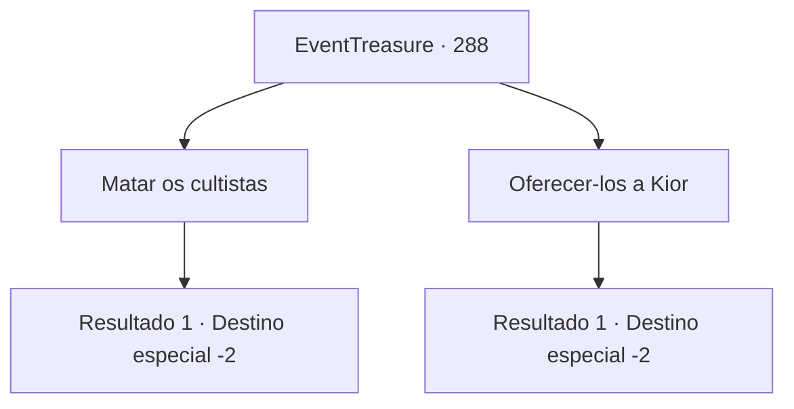

# Eventos de tesouro · 288

[Índice da tabela](index.md) · [Índice geral](../index.md)

ID: `pt:EventTreasure:288` · Fonte: `EventTreasure4` · Versão: 1.2.47.

Mapeamento estático dos arquivos; a disponibilidade e a execução dependem do estado da run.

## Texto do evento

*Sem texto no arquivo.*

## Dados de entrada

```json
{
  "id": 288,
  "grade": 1,
  "place": "",
  "required": ""
}
```

## Mapa das escolhas



## Escolhas e resultados

### Escolha 1

Matar os cultistas

Requisitos e outros campos da escolha:

```json
{
  "required": "5_431_1"
}
```

#### Resultado 1.1

Você não tem mais motivo para oferecer sacrifícios a Kior. Além disso, o apóstolo de Grimora pode estar associado a Kior, então você levanta uma pedra e acerta sua cabeça. O fanático, absorto na preparação do sacrifício, não antecipou seu ataque surpresa e morreu instantaneamente. Você revira sua toca, recolhe objetos úteis e sai da caverna.

Continuação registrada: [Destino especial `-2`](../destinos-especiais.md).

```json
{
  "required": "",
  "chance": "1",
  "nextEvent": -2,
  "type": 2,
  "reward": "5_546_9|0_4_50|3_216_1|0_2_1"
}
```

### Escolha 2

Oferecer-los a Kior

Requisitos e outros campos da escolha:

```json
{
  "required": "18_431_1"
}
```

#### Resultado 2.1

Você extrai as almas restantes das cabeças dos paladinos e as oferece a Kior. Kior parece satisfeito interiormente e murmura. 

 "Que sorte... esse tal Grimora, bastante útil."

 Quando seu ritual termina, Kior compartilha um pouco de poder com você. Al Harmutt também parece ter terminado seu sacrifício e se aproxima de você. Ele dá tapinhas em seu ombro e diz. 

 "Você, que compartilha a missão de iluminar os humanos tolos, desejo sorte. Pegue isso. Vai te ajudar."

 Você responde com um gesto de concordância às suas palavras, pega a poção que ele oferece e então sai da caverna com mau cheiro.

Continuação registrada: [Destino especial `-2`](../destinos-especiais.md).

```json
{
  "required": "",
  "chance": "1",
  "nextEvent": -2,
  "type": 2,
  "reward": "27_37_1|5_546_9|3_36_1|3_37_1|0_2_1"
}
```

## Referências que chegam a este evento

- [Evento 281 · escolha 2 · resultado 1](0281.md#escolha-2)
