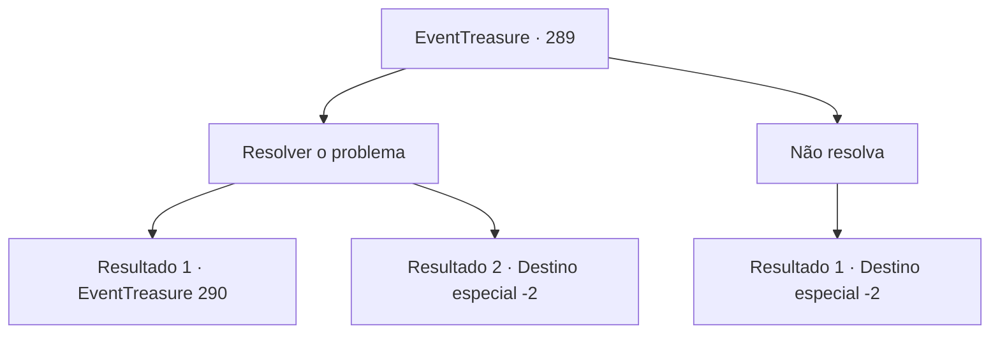

# Eventos de tesouro · 289

[Índice da tabela](index.md) · [Índice geral](../index.md)

ID: `pt:EventTreasure:289` · Fonte: `EventTreasure4` · Versão: 1.2.47.

Mapeamento estático dos arquivos; a disponibilidade e a execução dependem do estado da run.

## Texto do evento

 Você vê um pergaminho peculiar exposto em um quadro de avisos de uma vila, contendo um pedido diferente dos normais. O pergaminho apresenta um problema, afirmando que se você puder provar isso, você deve visitar a Guilda dos Matemáticos na cidade de 'Sluphs' no Império Zaipent. O problema diz: 'Se cada curva fechada no espaço tridimensional converge para um único ponto, o espaço é topologicamente equivalente a uma esfera?' 

 -Guilda de Matemáticos do Império Zaipent -

## Dados de entrada

```json
{
  "id": 289,
  "grade": 2,
  "place": "",
  "required": "26_4_1|1_2_50|5_548_0"
}
```

## Mapa das escolhas



## Escolhas e resultados

### Escolha 1

Resolver o problema

Requisitos e outros campos da escolha:

```json
{
  "required": ""
}
```

#### Resultado 1.1

Você decidiu reunir vários pedaços de pergaminho e tentar resolver o problema. O método para demonstrar o problema era tão difícil que não era algo que pudesse ser feito em um ou dois dias. Depois de refletir durante vários dias, você começou a entender o problema. Você sente que um pouco mais de reflexão te levará à solução.

Continuação registrada: [Evento 290](0290.md) na mesma tabela.

```json
{
  "required": "",
  "chance": "1|0_7_1",
  "nextEvent": 290,
  "type": 0,
  "reward": ""
}
```

#### Resultado 1.2

Você decidiu juntar um pouco de pergaminho e tentar resolver o problema. No entanto, o problema era tão difícil que não importava o quanto você refletisse, você não conseguia ver nenhuma pista para a solução. Eventualmente, você jogou o pergaminho fora.

Continuação registrada: [Destino especial `-2`](../destinos-especiais.md).

```json
{
  "required": "",
  "chance": "14",
  "nextEvent": -2,
  "type": 1,
  "reward": "5_548_9"
}
```

### Escolha 2

Não resolva

Requisitos e outros campos da escolha:

```json
{
  "required": ""
}
```

#### Resultado 2.1

Decide não resolver.

Continuação registrada: [Destino especial `-2`](../destinos-especiais.md).

```json
{
  "required": "",
  "chance": "1",
  "nextEvent": -2,
  "type": 2,
  "reward": "5_548_9"
}
```

## Referências que chegam a este evento

Nenhum `nextEvent` positivo da mesma tabela aponta para este nó. Isso não prova que seja inacessível: sorteio e estado de história podem selecioná-lo.

