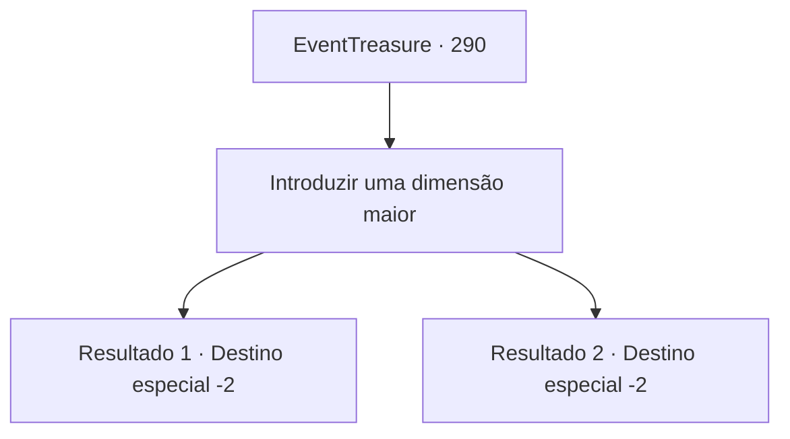

# Eventos de tesouro · 290

[Índice da tabela](index.md) · [Índice geral](../index.md)

ID: `pt:EventTreasure:290` · Fonte: `EventTreasure4` · Versão: 1.2.47.

Mapeamento estático dos arquivos; a disponibilidade e a execução dependem do estado da run.

## Texto do evento

*Sem texto no arquivo.*

## Dados de entrada

```json
{
  "id": 290,
  "grade": 1,
  "place": "",
  "required": ""
}
```

## Mapa das escolhas



## Escolhas e resultados

### Escolha 1

Introduzir uma dimensão maior

Requisitos e outros campos da escolha:

```json
{
  "required": ""
}
```

#### Resultado 1.1

Pensaste que o problema poderia ser resolvido mais facilmente em um espaço de maior dimensão. Após muita contemplação, finalmente consegues resolver o problema. Em seguida, organizas a em cerca de 50 folhas de pergaminho e diriges-te para 'Sluphs' no Zaipent.

Continuação registrada: [Destino especial `-2`](../destinos-especiais.md).

```json
{
  "required": "",
  "chance": "1|0_7_1",
  "nextEvent": -2,
  "type": 0,
  "reward": "5_548_1|3_271_1"
}
```

#### Resultado 1.2

Pensaste que o problema poderia ser mais fácil de resolver em um espaço de maior dimensão. No entanto, apesar de muito pensamento, você não consegue resolver o problema e eventualmente descarta o pergaminho.

Continuação registrada: [Destino especial `-2`](../destinos-especiais.md).

```json
{
  "required": "",
  "chance": "17",
  "nextEvent": -2,
  "type": 1,
  "reward": "5_548_9"
}
```

## Referências que chegam a este evento

- [Evento 289 · escolha 1 · resultado 1](0289.md#escolha-1)
