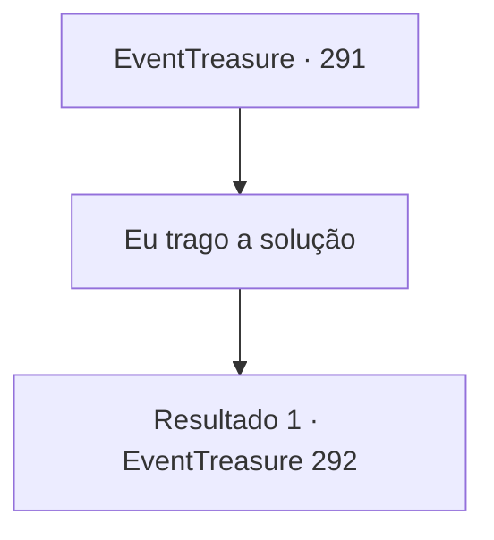

# Eventos de tesouro · 291

[Índice da tabela](index.md) · [Índice geral](../index.md)

ID: `pt:EventTreasure:291` · Fonte: `EventTreasure4` · Versão: 1.2.47.

Mapeamento estático dos arquivos; a disponibilidade e a execução dependem do estado da run.

## Texto do evento

Você chega à cidade de 'Sluphs' com o pergaminho contendo a definição do problema. Sluphs é uma cidade construída em uma planície enorme, com extensos campos que se estendem em ambos os lados. Moinhos de vento estão espalhados, girando alegremente com a brisa. Ao olhar ao redor, você se dirige para a 'Guilda de Matemáticos' localizada em Sluphs. Ao chegar ao prédio com a placa da guilda, você é recebido por um idoso sentado em uma cadeira de balanço, fumando um cachimbo. Ele olha para você com curiosidade e pergunta. 

 "Hum? Você tem algum negócio com nossa guilda?"


## Dados de entrada

```json
{
  "id": 291,
  "grade": 2,
  "place": "",
  "required": "8_271_1|5_548_1"
}
```

## Mapa das escolhas



## Escolhas e resultados

### Escolha 1

Eu trago a solução

Requisitos e outros campos da escolha:

```json
{
  "required": ""
}
```

#### Resultado 1.1

Você explica que veio aqui com uma solução para um problema publicado pela guilda de matemáticos. O ancião olha para você minuciosamente antes de estender a mão. 

 "Mostre-me."

 Você entrega sua solução e ele examina meticulosamente os documentos. Em seguida, ele se levanta de sua cadeira e entra. Você o segue. O prédio de madeira range sob seus passos. Logo, você entra em uma sala onde uma das paredes é um quadro negro grande. Há algo densamente escrito nele; é uma solução para o mesmo problema. O ancião se vira para você e diz, 

 "Não esperava que alguém resolvesse o problema tão rapidamente... mas sua solução está correta."

 Ele suspira profundamente antes de continuar, 

 "Então, gostaria de fazer uma proposta. Que tal me vender a solução para este problema?"

 Ele oferece 200 peças de ouro como condição para vender a solução.

Continuação registrada: [Evento 292](0292.md) na mesma tabela.

```json
{
  "required": "",
  "chance": "1",
  "nextEvent": 292,
  "type": 2,
  "reward": "4_271_1"
}
```

## Referências que chegam a este evento

Nenhum `nextEvent` positivo da mesma tabela aponta para este nó. Isso não prova que seja inacessível: sorteio e estado de história podem selecioná-lo.

