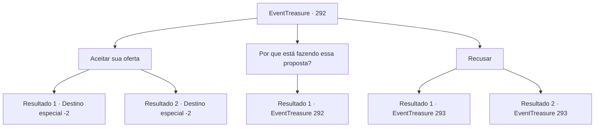

# Eventos de tesouro · 292

[Índice da tabela](index.md) · [Índice geral](../index.md)

ID: `pt:EventTreasure:292` · Fonte: `EventTreasure4` · Versão: 1.2.47.

Mapeamento estático dos arquivos; a disponibilidade e a execução dependem do estado da run.

## Texto do evento

*Sem texto no arquivo.*

## Dados de entrada

```json
{
  "id": 292,
  "grade": 1,
  "place": "",
  "required": ""
}
```

## Mapa das escolhas



## Escolhas e resultados

### Escolha 1

Aceitar sua oferta

Requisitos e outros campos da escolha:

```json
{
  "required": ""
}
```

#### Resultado 1.1

Você aceita a oferta dele. O ancião começa a explicar sua situação, mas engole suas palavras. 

 "Ah... só isso? Bem, vou te dar o ouro agora mesmo."

 Ele se apressa para algum lugar, depois volta e te entrega uma bolsa cheia de ouro. 

 "Obrigado. De verdade, obrigado!"

 E assim, você sai da Guilda do Matemático.

Continuação registrada: [Destino especial `-2`](../destinos-especiais.md).

```json
{
  "required": "18_549_1",
  "chance": "1",
  "nextEvent": -2,
  "type": 2,
  "reward": "5_548_9|0_4_200"
}
```

#### Resultado 1.2

Você aceita a oferta dele. O idoso, ao ouvir sua resposta, parece surpreso. 

 "Tão rapidamente? Ah, entendi. Vou trazer o ouro imediatamente."

 Então ele se apressa para tropeçar em algum lugar, antes de voltar para entregar uma bolsa cheia de ouro. 

 "Obrigado! De verdade, obrigado!"

 E assim, você sai da Guilda dos Matemáticos.

Continuação registrada: [Destino especial `-2`](../destinos-especiais.md).

```json
{
  "required": "5_549_1",
  "chance": "1",
  "nextEvent": -2,
  "type": 2,
  "reward": "5_548_9|0_4_200"
}
```

### Escolha 2

Por que está fazendo essa proposta?

Requisitos e outros campos da escolha:

```json
{
  "required": "5_549_0"
}
```

#### Resultado 2.1

Antecipando sua pergunta, o ancião responde instantaneamente. 

 "Permita-me me apresentar primeiro. Sou um matemático chamado 'Nikolai'. O problema que você resolveu é o que os matemáticos consideram o desafio do século. Resolvê-lo é uma honra incrível para qualquer matemático."

 Sua voz fica cada vez mais emocionada enquanto fala. 

 "Tenho refletido sobre esse problema por anos, assim como muitos outros matemáticos. Suspeito que, como aventureiro, você poderia encontrar o dinheiro mais útil do que tais honras, daí minha proposta. Sinceramente, espero que você a considere generosamente."


Continuação registrada: [Evento 292](0292.md) na mesma tabela.

```json
{
  "required": "",
  "chance": "1",
  "nextEvent": 292,
  "type": 2,
  "reward": "5_549_1"
}
```

### Escolha 3

Recusar

Requisitos e outros campos da escolha:

```json
{
  "required": ""
}
```

#### Resultado 3.1

Você rejeita o pedido do idoso. Ele lambe os lábios em aparente decepção. 

 "Hmm... Entendo. Não há nada a ser feito. Parece que você também tem paixão por matemática... Eu sou Nikolai. Prazer em conhecê-lo."

 Você aperta a mão dele. 

 "Preciso informar meus colegas matemáticos que esse problema foi resolvido. Esta não é uma cidade especial, mas sugiro que passe algum tempo aqui. Quando a conferência acontecer, precisaremos apresentar sua solução aqui."

 O idoso oferece um pouco de ouro para que você fique na pousada por um tempo.

Continuação registrada: [Evento 293](0293.md) na mesma tabela.

```json
{
  "required": "18_549_1",
  "chance": "1",
  "nextEvent": 293,
  "type": 2,
  "reward": "0_4_20"
}
```

#### Resultado 3.2

Você rejeita o pedido do idoso. Ele lambe os lábios em aparente decepção. 

 "Hmm... Entendo. Não há nada a ser feito. Parece que você também tem paixão por matemática... Prazer em conhecê-lo."

 Você aperta a mão dele. 

 "Preciso informar meus colegas matemáticos que esse problema foi resolvido. Esta não é uma cidade especial, mas sugiro que você passe algum tempo aqui. Quando a conferência acontecer, precisaremos apresentar sua solução aqui."

 O idoso oferece um pouco de ouro para que você fique na pousada por um tempo.

Continuação registrada: [Evento 293](0293.md) na mesma tabela.

```json
{
  "required": "5_549_1",
  "chance": "1",
  "nextEvent": 293,
  "type": 2,
  "reward": "0_4_20"
}
```

## Referências que chegam a este evento

- [Evento 291 · escolha 1 · resultado 1](0291.md#escolha-1)
- [Evento 292 · escolha 2 · resultado 1](0292.md#escolha-2)
