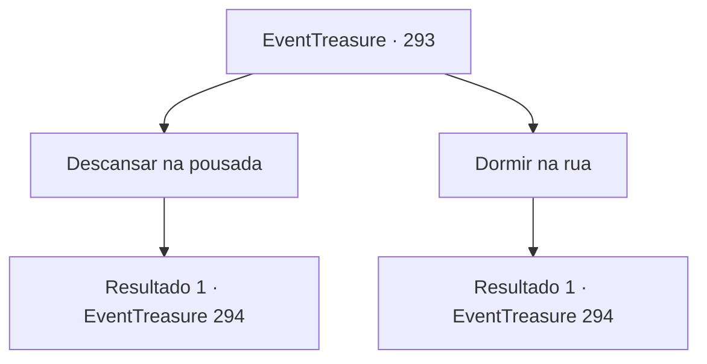

# Eventos de tesouro · 293

[Índice da tabela](index.md) · [Índice geral](../index.md)

ID: `pt:EventTreasure:293` · Fonte: `EventTreasure4` · Versão: 1.2.47.

Mapeamento estático dos arquivos; a disponibilidade e a execução dependem do estado da run.

## Texto do evento

*Sem texto no arquivo.*

## Dados de entrada

```json
{
  "id": 293,
  "grade": 1,
  "place": "",
  "required": ""
}
```

## Mapa das escolhas



## Escolhas e resultados

### Escolha 1

Descansar na pousada

Requisitos e outros campos da escolha:

```json
{
  "required": ""
}
```

#### Resultado 1.1

Você descansa na pousada da cidade por aproximadamente dois dias. Em seguida, Nikolai vem em sua direção. 

 "Os preparativos para a conferência estão agora completos. Venha, jovem matemático."

 Você o segue de volta para a guilda de matemáticos. Dentro do prédio da guilda, há muitos matemáticos. Eles se apresentam enquanto te observam com interesse. Após trocar breves cumprimentos, eles te pedem para apresentar sua solução diante deles.

Continuação registrada: [Evento 294](0294.md) na mesma tabela.

```json
{
  "required": "",
  "chance": "1",
  "nextEvent": 294,
  "type": 2,
  "reward": "0_0_1|0_1_1|0_4_-20"
}
```

### Escolha 2

Dormir na rua

Requisitos e outros campos da escolha:

```json
{
  "required": ""
}
```

#### Resultado 2.1

Você caminhou pela cidade, esperando que os matemáticos se reunissem. Aproximadamente dois dias depois, Nikolai vem em sua direção. 

 "Os preparativos para a conferência estão agora completos. Venha, jovem matemático."

 Você o segue de volta para a guilda de matemáticos. Dentro do prédio da guilda, há muitos matemáticos. Eles se apresentam enquanto te observam com interesse. Após trocar breves cumprimentos, eles te pedem para apresentar sua solução diante deles.

Continuação registrada: [Evento 294](0294.md) na mesma tabela.

```json
{
  "required": "",
  "chance": "1",
  "nextEvent": 294,
  "type": 2,
  "reward": ""
}
```

## Referências que chegam a este evento

- [Evento 292 · escolha 3 · resultado 1](0292.md#escolha-3)
- [Evento 292 · escolha 3 · resultado 2](0292.md#escolha-3)
