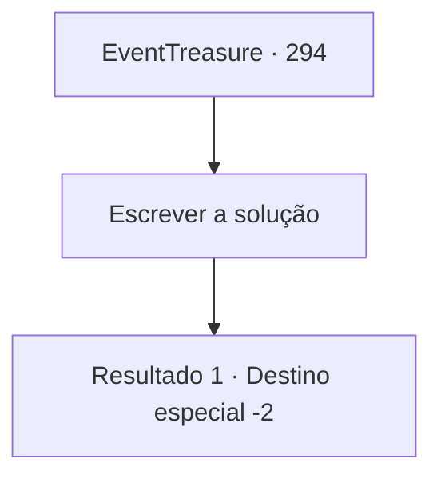

# Eventos de tesouro · 294

[Índice da tabela](index.md) · [Índice geral](../index.md)

ID: `pt:EventTreasure:294` · Fonte: `EventTreasure4` · Versão: 1.2.47.

Mapeamento estático dos arquivos; a disponibilidade e a execução dependem do estado da run.

## Texto do evento

*Sem texto no arquivo.*

## Dados de entrada

```json
{
  "id": 294,
  "grade": 1,
  "place": "",
  "required": ""
}
```

## Mapa das escolhas



## Escolhas e resultados

### Escolha 1

Escrever a solução

Requisitos e outros campos da escolha:

```json
{
  "required": ""
}
```

#### Resultado 1.1

Você preencheu o quadro com sua solução. Os matemáticos observaram sua solução com olhos brilhantes. Passaram horas e depois de várias rodadas de debate, concluíram que você havia resolvido o problema. 

 "É realmente notável... um aventureiro resolvendo o enigma deste século."

 Expressam sua gratidão por resolver o enigma do século e te entregam o prêmio em ouro. Imediatamente depois, você agradece e se despede do grupo.

Continuação registrada: [Destino especial `-2`](../destinos-especiais.md).

```json
{
  "required": "",
  "chance": "1",
  "nextEvent": -2,
  "type": 2,
  "reward": "0_4_100|27_24_1|0_2_1|5_548_9"
}
```

## Referências que chegam a este evento

- [Evento 293 · escolha 1 · resultado 1](0293.md#escolha-1)
- [Evento 293 · escolha 2 · resultado 1](0293.md#escolha-2)
