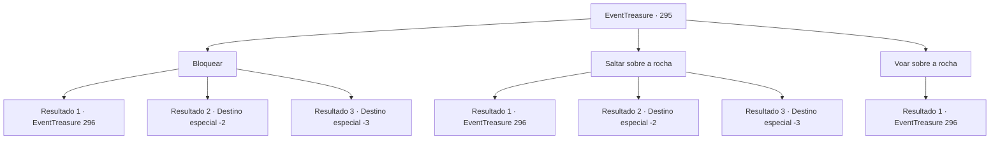

# Eventos de tesouro · 295

[Índice da tabela](index.md) · [Índice geral](../index.md)

ID: `pt:EventTreasure:295` · Fonte: `EventTreasure4` · Versão: 1.2.47.

Mapeamento estático dos arquivos; a disponibilidade e a execução dependem do estado da run.

## Texto do evento

Você está escalando a montanha rochosa e começa a sentir os tremores crescentes no solo. Os tremores estão ficando cada vez mais fortes. Em pouco tempo, você descobre a fonte das vibrações, é uma pedra enorme rolando em sua direção.

## Dados de entrada

```json
{
  "id": 295,
  "grade": 2,
  "place": "",
  "required": "26_15_1|1_2_50|5_550_0"
}
```

## Mapa das escolhas



## Escolhas e resultados

### Escolha 1

Bloquear

Requisitos e outros campos da escolha:

```json
{
  "required": "20_9_1"
}
```

#### Resultado 1.1

Você parou a rocha rolante e a afastou. Com isso, a rocha bateu no penhasco e, naquele momento, foi possível ouvir um gemido baixo em algum lugar. 

 "Argh... Uh... o que é isso?"

 Inseguro da fonte do barulho, você olha ao redor. De repente, uma parte do penhasco se agita e se levanta. É uma criatura conhecida como um gigante de pedra. 

 "Hmm... Um humano? Não muitos vêm aqui... Você me acordou?"

 O gigante de pedra pergunta com uma voz suave.

Continuação registrada: [Evento 296](0296.md) na mesma tabela.

```json
{
  "required": "",
  "chance": "1|0_5_1|0_13_1",
  "nextEvent": 296,
  "type": 0,
  "reward": "5_550_1"
}
```

#### Resultado 1.2

Tentaste parar a rocha rolante, mas falhaste. Com um estrondoso 'choque', a rocha que bate em ti desmorona-se e cais bruscamente no chão devido ao impacto. Nesse momento, um gemido baixo ressoa de algum lugar. 

 "Oh, estás bem, pequeno humano?"

 Inseguro de onde vem o som, olhas ao teu redor. Depois, uma parte do penhasco move-se e ergue-se. É uma entidade conhecida como um gigante de pedra. 

 "Deve doer. Toma isto."

 Procura através de uma bolsa frondosa ao seu lado e oferece-te uma pequena poção. Depois, mistura-se novamente com a rocha. Juntas as mãos para expressar gratidão e continuas a tua subida pela montanha rochosa.

Continuação registrada: [Destino especial `-2`](../destinos-especiais.md).

```json
{
  "required": "1_0_2",
  "chance": "32",
  "nextEvent": -2,
  "type": 1,
  "reward": "5_550_9|3_190_1|0_0_-1"
}
```

#### Resultado 1.3

Tentaste parar a rocha rolante, mas falhaste. Com um estrondoso 'choque!', a rocha que colide contigo se despedaça, e cais bruscamente no chão devido ao impacto. E então, perdes a consciência.

Continuação registrada: [Destino especial `-3`](../destinos-especiais.md).

```json
{
  "required": "2_0_2",
  "chance": "32",
  "nextEvent": -3,
  "type": 1,
  "reward": "0_0_-1"
}
```

### Escolha 2

Saltar sobre a rocha

Requisitos e outros campos da escolha:

```json
{
  "required": ""
}
```

#### Resultado 2.1

Você saltou rapidamente sobre a rocha rolante. Com isso, a rocha bateu no penhasco e, nesse momento, foi possível ouvir um gemido baixo em algum lugar. 

 "Argh... Uh... o que é isso...?"

 Inseguro da fonte do barulho, você olha ao redor. De repente, uma parte do penhasco se agita e se levanta. É uma criatura conhecida como um gigante de pedra. 

 "Hmm... Um humano? Não muitos vêm aqui... Você me acordou?"

 O gigante de pedra pergunta com uma voz suave.

Continuação registrada: [Evento 296](0296.md) na mesma tabela.

```json
{
  "required": "",
  "chance": "1|0_6_1",
  "nextEvent": 296,
  "type": 0,
  "reward": "5_550_1"
}
```

#### Resultado 2.2

Tentas saltar rapidamente sobre a pedra rolante, mas falhas. Com um estrondoso 'crash!', a pedra que choca contigo se quebra e cais bruscamente no chão devido ao impacto. Nesse momento, um gemido baixo ressoa de algum lugar. 

 "Oh, estás bem, pequeno humano?"

 Inseguro de onde vem o som, olhas ao redor. Então, uma parte do penhasco se move e se levanta. É uma entidade conhecida como um gigante de pedra. 

 "Isso deve doer. Toma isso."

 Procura através de uma bolsa frondosa em seu lado e te oferece uma pequena poção. Depois, mistura-se novamente com a rocha. Juntas as mãos para expressar gratidão e continuas tua ascensão pela montanha rochosa.

Continuação registrada: [Destino especial `-2`](../destinos-especiais.md).

```json
{
  "required": "1_0_2",
  "chance": "16",
  "nextEvent": -2,
  "type": 1,
  "reward": "5_550_9|3_190_1|0_0_-1"
}
```

#### Resultado 2.3

Tentas saltar rapidamente sobre a rocha rolante, mas falhas. Com um estrondoso '¡crash!', a rocha que choca contigo se quebra e cais bruscamente no chão devido ao impacto. E então, perdes a consciência.

Continuação registrada: [Destino especial `-3`](../destinos-especiais.md).

```json
{
  "required": "2_0_2",
  "chance": "16",
  "nextEvent": -3,
  "type": 1,
  "reward": "0_0_-1"
}
```

### Escolha 3

Voar sobre a rocha

Requisitos e outros campos da escolha:

```json
{
  "required": "-1|20_10_1|20_0_2"
}
```

#### Resultado 3.1

Você saltou rapidamente sobre a rocha rolante. Com isso, a rocha bateu no penhasco e, nesse momento, foi possível ouvir um gemido baixo em algum lugar. 

 "Argh... Uh... o que é isso...?"

 Inseguro da fonte do barulho, você olha ao redor. De repente, uma parte do penhasco se agita e se levanta. É uma criatura conhecida como um gigante de pedra. 

 "Hmm... Um humano? Não muitos vêm aqui... Você me acordou?"

 O gigante de pedra pergunta com uma voz suave.

Continuação registrada: [Evento 296](0296.md) na mesma tabela.

```json
{
  "required": "",
  "chance": "1",
  "nextEvent": 296,
  "type": 2,
  "reward": "5_550_1"
}
```

## Referências que chegam a este evento

Nenhum `nextEvent` positivo da mesma tabela aponta para este nó. Isso não prova que seja inacessível: sorteio e estado de história podem selecioná-lo.

