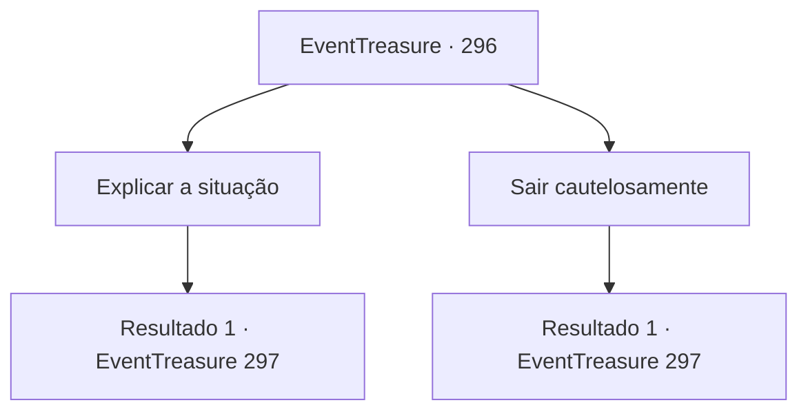

# Eventos de tesouro · 296

[Índice da tabela](index.md) · [Índice geral](../index.md)

ID: `pt:EventTreasure:296` · Fonte: `EventTreasure4` · Versão: 1.2.47.

Mapeamento estático dos arquivos; a disponibilidade e a execução dependem do estado da run.

## Texto do evento

*Sem texto no arquivo.*

## Dados de entrada

```json
{
  "id": 296,
  "grade": 1,
  "place": "",
  "required": ""
}
```

## Mapa das escolhas



## Escolhas e resultados

### Escolha 1

Explicar a situação

Requisitos e outros campos da escolha:

```json
{
  "required": ""
}
```

#### Resultado 1.1

Explica a situação ao gigante de pedra. O gigante de pedra assente, entendendo. Em seguida, aparece outro gigante de pedra. 

 "Sinto muito por isso, pequeno. Por favor, aceite minhas desculpas."


Continuação registrada: [Evento 297](0297.md) na mesma tabela.

```json
{
  "required": "",
  "chance": "1",
  "nextEvent": 297,
  "type": 2,
  "reward": ""
}
```

### Escolha 2

Sair cautelosamente

Requisitos e outros campos da escolha:

```json
{
  "required": ""
}
```

#### Resultado 2.1

Você se afasta cautelosamente do gigante de pedra. Em resposta, o gigante de pedra levanta suas mãos, mostrando nenhuma intenção de atacar. 

 "Não se assuste muito, pequeno. Não tenho intenção de te machucar."


Continuação registrada: [Evento 297](0297.md) na mesma tabela.

```json
{
  "required": "",
  "chance": "1",
  "nextEvent": 297,
  "type": 2,
  "reward": ""
}
```

## Referências que chegam a este evento

- [Evento 295 · escolha 1 · resultado 1](0295.md#escolha-1)
- [Evento 295 · escolha 2 · resultado 1](0295.md#escolha-2)
- [Evento 295 · escolha 3 · resultado 1](0295.md#escolha-3)
