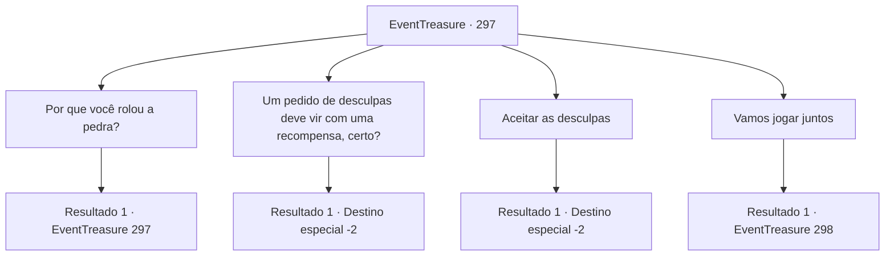

# Eventos de tesouro · 297

[Índice da tabela](index.md) · [Índice geral](../index.md)

ID: `pt:EventTreasure:297` · Fonte: `EventTreasure4` · Versão: 1.2.47.

Mapeamento estático dos arquivos; a disponibilidade e a execução dependem do estado da run.

## Texto do evento

*Sem texto no arquivo.*

## Dados de entrada

```json
{
  "id": 297,
  "grade": 1,
  "place": "",
  "required": ""
}
```

## Mapa das escolhas



## Escolhas e resultados

### Escolha 1

Por que você rolou a pedra?

Requisitos e outros campos da escolha:

```json
{
  "required": "5_551_0"
}
```

#### Resultado 1.1

Quando perguntado, o gigante de pedra coça a cabeça e diz: 

 "Hmm... por tédio? Entre nós, muitas vezes rolamos pedras para nos divertir."

 Então outro gigante de pedra concorda. 

 "Isso é verdade. Normalmente não as rolamos em direção aos adormecidos, no entanto."


Continuação registrada: [Evento 297](0297.md) na mesma tabela.

```json
{
  "required": "",
  "chance": "1",
  "nextEvent": 297,
  "type": 2,
  "reward": "5_551_1"
}
```

### Escolha 2

Um pedido de desculpas deve vir com uma recompensa, certo?

Requisitos e outros campos da escolha:

```json
{
  "required": ""
}
```

#### Resultado 2.1

Você disse aos gigantes de pedra que um pedido de desculpas deveria ser seguido de uma compensação monetária. Então, o gigante de pedra coça a cabeça desconfortavelmente e diz: 

 "Pequeno humano. Não temos suas pequenas moedas... Bem, que tal isso?"

 O gigante de pedra revira uma bolsa de folhas em sua cintura, tirando um pedaço de mithril. E então ele te entrega. Você aceita o pedaço de mithril e se despede dos gigantes de pedra.

Continuação registrada: [Destino especial `-2`](../destinos-especiais.md).

```json
{
  "required": "",
  "chance": "1",
  "nextEvent": -2,
  "type": 2,
  "reward": "5_550_9|3_129_1"
}
```

### Escolha 3

Aceitar as desculpas

Requisitos e outros campos da escolha:

```json
{
  "required": ""
}
```

#### Resultado 3.1

Você aceitou o pedido de desculpas do gigante de pedra. Ele mostra um sorriso satisfeito e diz, 

 "Obrigado, pequeno humano. Não é muito, mas encontrei um lenço que alguém deixou cair. Você não quer pegar um?"

 O gigante de pedra revira uma bolsa de folhas em sua cintura, tirando uma túnica. E então ele te entrega. Você aceita a túnica e se despede dos gigantes de pedra.

Continuação registrada: [Destino especial `-2`](../destinos-especiais.md).

```json
{
  "required": "",
  "chance": "1",
  "nextEvent": -2,
  "type": 2,
  "reward": "5_550_9|3_30_1|0_3_1"
}
```

### Escolha 4

Vamos jogar juntos

Requisitos e outros campos da escolha:

```json
{
  "required": "5_551_1"
}
```

#### Resultado 4.1

Você pede para se juntar ao 'jogo' dos gigantes de pedra. Os gigantes se olham por um momento e então começam a rir. 

 "Ha-ha-ha! Pequeno humano. Pode ser perigoso para você, tem certeza?"

 Você assente novamente e eles permitem que você se junte ao jogo a contragosto. Primeiro, um dos gigantes de pedra pega uma pedra redonda e a coloca no chão. E então olha para outro gigante de pedra e diz, 

 "Tudo bem. Aqui vai, 'Sulas'."

 Ele chuta a bola de pedra em direção ao outro gigante. Sulas, como é chamado, se prepara e recebe a pedra com o pé. Em seguida, Sulas coloca a pedra no chão. 

 "É a minha vez. Pega, 'Renturi'."

 A bola de pedra chutada por Sulas rola de volta em direção a Renturi. Ele a para com a parte interna do pé e te olha. 

 "Tudo bem, pequeno humano, pegue."

 Renturi chuta levemente o que é uma bola para os gigantes, mas para você, é uma pedra quase tão alta quanto você.

Continuação registrada: [Evento 298](0298.md) na mesma tabela.

```json
{
  "required": "",
  "chance": "1",
  "nextEvent": 298,
  "type": 2,
  "reward": ""
}
```

## Referências que chegam a este evento

- [Evento 296 · escolha 1 · resultado 1](0296.md#escolha-1)
- [Evento 296 · escolha 2 · resultado 1](0296.md#escolha-2)
- [Evento 297 · escolha 1 · resultado 1](0297.md#escolha-1)
