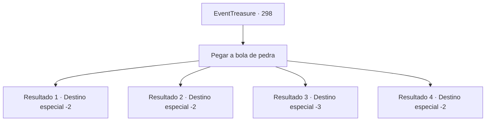

# Eventos de tesouro · 298

[Índice da tabela](index.md) · [Índice geral](../index.md)

ID: `pt:EventTreasure:298` · Fonte: `EventTreasure4` · Versão: 1.2.47.

Mapeamento estático dos arquivos; a disponibilidade e a execução dependem do estado da run.

## Texto do evento

*Sem texto no arquivo.*

## Dados de entrada

```json
{
  "id": 298,
  "grade": 1,
  "place": "",
  "required": ""
}
```

## Mapa das escolhas



## Escolhas e resultados

### Escolha 1

Pegar a bola de pedra

Requisitos e outros campos da escolha:

```json
{
  "required": ""
}
```

#### Resultado 1.1

Você conseguiu pegar a bola de pedra e a rolou de volta para os gigantes. Depois de algumas rodadas passando de um lado para o outro, Sulas aplaude e diz: 

 "Bem feito, pequeno humano resistente! Nos divertimos muito. Vamos lembrar do seu nome."

 Em seguida, Renturi, que estava ao lado dele, também sorri e diz: 

 "Obrigado por jogar! Adoraríamos te ver novamente. Adeus."

 Os gigantes de pedra voltam para suas próprias rochas, e você também se despede deles.

Continuação registrada: [Destino especial `-2`](../destinos-especiais.md).

```json
{
  "required": "21_9_4",
  "chance": "1|0_5_1",
  "nextEvent": -2,
  "type": 0,
  "reward": "27_38_1|0_2_1"
}
```

#### Resultado 1.2

Tentas pegar a bola de pedra, mas o seu peso te esmaga. Terias sido esmagado até a morte se os gigantes de pedra não tivessem chegado correndo e a tivessem tirado. 

 "Estás bem..? Talvez este jogo seja melhor aproveitado entre nós."

 O gigante de pedra revira o seu bolso e te entrega uma poção. 

 "Bebe isso."

 Aceitas a poção e te despedes dos gigantes.

Continuação registrada: [Destino especial `-2`](../destinos-especiais.md).

```json
{
  "required": "21_9_4|1_0_2",
  "chance": "18",
  "nextEvent": -2,
  "type": 1,
  "reward": "3_190_1|0_0_-1"
}
```

#### Resultado 1.3

Tentaste pegar a bola de pedra, mas acabaste sendo esmagado pelo seu peso. Os gigantes de pedra correram assustados e afastaram-na, mas tu estavas ofegante pelo esforço.

Continuação registrada: [Destino especial `-3`](../destinos-especiais.md).

```json
{
  "required": "21_9_4|2_0_2",
  "chance": "18",
  "nextEvent": -3,
  "type": 1,
  "reward": "0_0_-1"
}
```

#### Resultado 1.4

Você conseguiu pegar a bola de pedra e a rolou de volta para os gigantes. Depois de algumas rodadas passando de um lado para o outro, Sulas aplaude e diz: 

 "Bem feito, pequeno humano resistente! Nos divertimos muito. Vamos lembrar do seu nome."

 Em seguida, Renturi, que estava ao lado dele, também sorri e diz: 

 "Obrigado por jogar! Adoraríamos te ver novamente. Adeus."

 Os gigantes de pedra voltam para suas próprias rochas, e você também se despede deles.

Continuação registrada: [Destino especial `-2`](../destinos-especiais.md).

```json
{
  "required": "20_9_4",
  "chance": "1",
  "nextEvent": -2,
  "type": 2,
  "reward": "27_38_1|0_2_1"
}
```

## Referências que chegam a este evento

- [Evento 297 · escolha 4 · resultado 1](0297.md#escolha-4)
