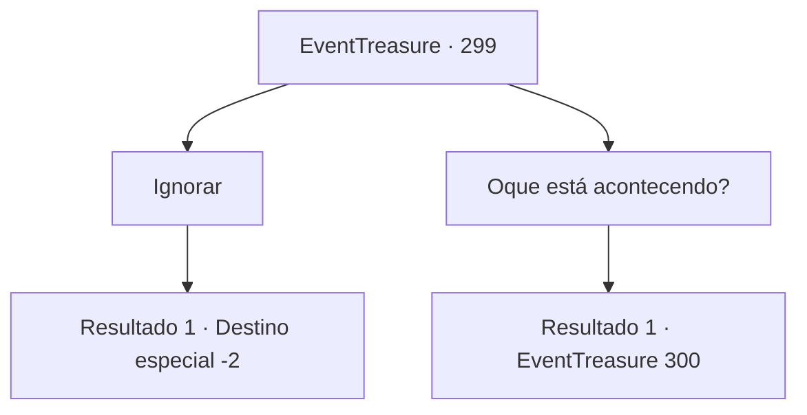

# Eventos de tesouro · 299

[Índice da tabela](index.md) · [Índice geral](../index.md)

ID: `pt:EventTreasure:299` · Fonte: `EventTreasure4` · Versão: 1.2.47.

Mapeamento estático dos arquivos; a disponibilidade e a execução dependem do estado da run.

## Texto do evento

Você está vagando pelas ruas de uma cidade chamada 'Colina Hols'. 

 "Ei, aventureiro. Espere um momento."

 De repente, uma garota se aproxima de você. Ela está usando um vestido vermelho com renda, e à primeira vista, ela não parece pertencer a uma classe comum.

## Dados de entrada

```json
{
  "id": 299,
  "grade": 2,
  "place": "",
  "required": "26_14_1|1_2_50|5_552_0"
}
```

## Mapa das escolhas



## Escolhas e resultados

### Escolha 1

Ignorar

Requisitos e outros campos da escolha:

```json
{
  "required": ""
}
```

#### Resultado 1.1

Ignoras a ligação da nobre garota e te escondes entre a multidão. Ela sente sua falta e segue em frente para outro lugar.

Continuação registrada: [Destino especial `-2`](../destinos-especiais.md).

```json
{
  "required": "",
  "chance": "1",
  "nextEvent": -2,
  "type": 2,
  "reward": "5_552_9"
}
```

### Escolha 2

Oque está acontecendo?

Requisitos e outros campos da escolha:

```json
{
  "required": ""
}
```

#### Resultado 2.1


 "Não fiquemos aqui, vamos para a casa de chá."

 Ela te leva para uma casa de chá. A casa de chá, conhecida como um local de encontro para a nobreza, está cheia de decorações luxuosas. Sentada em um canto da loja, ela pede uma xícara de chá preto e começa a falar. 

 "Eu sou 'Lenia', filha do Conde Hols. Tenho um favor para pedir. Você pode ir ao baile no meu lugar? Eu vou te recompensar generosamente."


Continuação registrada: [Evento 300](0300.md) na mesma tabela.

```json
{
  "required": "",
  "chance": "1",
  "nextEvent": 300,
  "type": 2,
  "reward": "5_552_1"
}
```

## Referências que chegam a este evento

Nenhum `nextEvent` positivo da mesma tabela aponta para este nó. Isso não prova que seja inacessível: sorteio e estado de história podem selecioná-lo.

