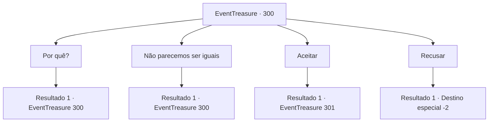

# Eventos de tesouro · 300

[Índice da tabela](index.md) · [Índice geral](../index.md)

ID: `pt:EventTreasure:300` · Fonte: `EventTreasure4` · Versão: 1.2.47.

Mapeamento estático dos arquivos; a disponibilidade e a execução dependem do estado da run.

## Texto do evento

*Sem texto no arquivo.*

## Dados de entrada

```json
{
  "id": 300,
  "grade": 1,
  "place": "",
  "required": ""
}
```

## Mapa das escolhas



## Escolhas e resultados

### Escolha 1

Por quê?

Requisitos e outros campos da escolha:

```json
{
  "required": "5_553_0"
}
```

#### Resultado 1.1

Logo quando o garçom traz o chá preto, Lenia mexe um pouco de açúcar com uma colherinha. Mesmo assim, seus olhos permanecem fixos em você. Ela te olha por um momento, solta um pequeno suspiro e diz: 

 "Tenho um pouco de... uma história familiar complicada. De qualquer forma, tudo que você precisa fazer é ir ao baile de máscaras e agir como se fosse 'eu'"


Continuação registrada: [Evento 300](0300.md) na mesma tabela.

```json
{
  "required": "",
  "chance": "1",
  "nextEvent": 300,
  "type": 2,
  "reward": "5_553_1"
}
```

### Escolha 2

Não parecemos ser iguais

Requisitos e outros campos da escolha:

```json
{
  "required": "5_554_0"
}
```

#### Resultado 2.1

Você se perguntou como isso poderia funcionar, considerando que você se vê diferente. Diante disso, ela sorri em silêncio, os cantos de sua boca se levantam com diversão. 

 "Há maneiras. Não se preocupe com isso."

 Ela explica que tem um vestido mágico. Ao usá-lo, você pode assumir a aparência dela.

Continuação registrada: [Evento 300](0300.md) na mesma tabela.

```json
{
  "required": "",
  "chance": "1",
  "nextEvent": 300,
  "type": 2,
  "reward": "5_554_1"
}
```

### Escolha 3

Aceitar

Requisitos e outros campos da escolha:

```json
{
  "required": ""
}
```

#### Resultado 3.1

Decidiste aceitar o pedido de amizade de Lenia. Em seguida, ela mencionou que há algo que você precisa fazer e pediu para que a siga. Portanto, você a seguiu até a casa do Conde de Hols. 

 A casa do Conde de Hols, assim como as de outros nobres, é adornada com um amplo jardim, uma magnífica fonte de mármore e flores e plantas bem cuidadas. Ao chegar na entrada principal da mansão, o porteiro suspira e diz: 

 "Suspiro... Senhorita... Quando você foi embora novamente? Quem é esse ao seu lado... Isso realmente me coloca em uma situação difícil."

 No entanto, Lenia ri e dá tapinhas no ombro dele, 

 "Hahaha! Está tudo bem, vou explicar tudo~!"

 Com uma expressão sombria, o porteiro abre a porta e você e Lenia atravessam o espaçoso jardim para entrar na mansão. Ao abrir a porta de cor bege claro e entrar na mansão, a voz profunda de um homem de meia-idade ressoa, 

 "Lenia, para onde você está indo sem dizer uma palavra?"

 Surpresa, Lenia gagueja. 

 "Uh... oh, papai... Por que você está aqui a essa hora...?"

 Sua resposta parece ter irritado ainda mais seu pai, que torce o bigode e pergunta em voz alta. 

 "Eu não te disse para se preparar seriamente para o baile de máscaras? E quem é esse ao seu lado?"


Continuação registrada: [Evento 301](0301.md) na mesma tabela.

```json
{
  "required": "",
  "chance": "1",
  "nextEvent": 301,
  "type": 2,
  "reward": ""
}
```

### Escolha 4

Recusar

Requisitos e outros campos da escolha:

```json
{
  "required": ""
}
```

#### Resultado 4.1

Você recusou o pedido de Lenia. Ela sorve seu chá e diz: 'É assim? Que pena.' Então ela faz um gesto para que você vá embora. Você sai da luxuosa casa de chá e volta para a sua aventura.

Continuação registrada: [Destino especial `-2`](../destinos-especiais.md).

```json
{
  "required": "",
  "chance": "1",
  "nextEvent": -2,
  "type": 2,
  "reward": "5_552_9"
}
```

## Referências que chegam a este evento

- [Evento 299 · escolha 2 · resultado 1](0299.md#escolha-2)
- [Evento 300 · escolha 1 · resultado 1](0300.md#escolha-1)
- [Evento 300 · escolha 2 · resultado 1](0300.md#escolha-2)
