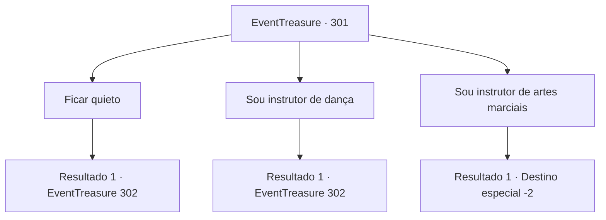

# Eventos de tesouro · 301

[Índice da tabela](index.md) · [Índice geral](../index.md)

ID: `pt:EventTreasure:301` · Fonte: `EventTreasure4` · Versão: 1.2.47.

Mapeamento estático dos arquivos; a disponibilidade e a execução dependem do estado da run.

## Texto do evento

*Sem texto no arquivo.*

## Dados de entrada

```json
{
  "id": 301,
  "grade": 1,
  "place": "",
  "required": ""
}
```

## Mapa das escolhas



## Escolhas e resultados

### Escolha 1

Ficar quieto

Requisitos e outros campos da escolha:

```json
{
  "required": ""
}
```

#### Resultado 1.1

Fique quieto, olhando para Lenia. Surpreendida, rapidamente inventa uma desculpa, apresentando você como seu 'instrutor de dança'. Ao ouvir isso, o Conde Hols olha para você e diz, 

 "Hmm, é isso mesmo? Bem, então, mostre-nos suas habilidades."


Continuação registrada: [Evento 302](0302.md) na mesma tabela.

```json
{
  "required": "",
  "chance": "1",
  "nextEvent": 302,
  "type": 2,
  "reward": ""
}
```

### Escolha 2

Sou instrutor de dança

Requisitos e outros campos da escolha:

```json
{
  "required": ""
}
```

#### Resultado 2.1

Você, em vez da desconcertada Lenia, se apresentou como instrutor de dança. Ao ouvir isso, o Conde Hols te olha e diz: 

 "Hmm, é assim? Bem, então, mostre-me suas habilidades."


Continuação registrada: [Evento 302](0302.md) na mesma tabela.

```json
{
  "required": "",
  "chance": "1",
  "nextEvent": 302,
  "type": 2,
  "reward": ""
}
```

### Escolha 3

Sou instrutor de artes marciais

Requisitos e outros campos da escolha:

```json
{
  "required": ""
}
```

#### Resultado 3.1

Você, em vez da desconcertada Lenia, se apresentou como instrutor de artes marciais. Isso faz com que as têmporas do Conde Hols inchem com veias grossas. Sua fúria explode como um vulcão. <link=shake>

 "Outro instrutor de artes marciais?! Fora! Saia agora mesmo!!"

</link> Lenia suspira enquanto pressiona a testa, e os servos do Conde Hols se aproximam de você para te escoltar para fora.

Continuação registrada: [Destino especial `-2`](../destinos-especiais.md).

```json
{
  "required": "",
  "chance": "1",
  "nextEvent": -2,
  "type": 2,
  "reward": "5_552_9"
}
```

## Referências que chegam a este evento

- [Evento 300 · escolha 3 · resultado 1](0300.md#escolha-3)
