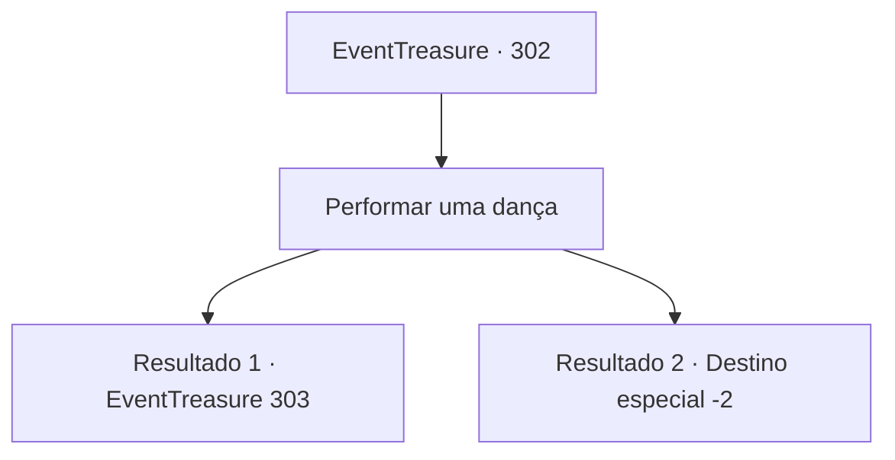

# Eventos de tesouro · 302

[Índice da tabela](index.md) · [Índice geral](../index.md)

ID: `pt:EventTreasure:302` · Fonte: `EventTreasure4` · Versão: 1.2.47.

Mapeamento estático dos arquivos; a disponibilidade e a execução dependem do estado da run.

## Texto do evento

*Sem texto no arquivo.*

## Dados de entrada

```json
{
  "id": 302,
  "grade": 1,
  "place": "",
  "required": ""
}
```

## Mapa das escolhas



## Escolhas e resultados

### Escolha 1

Performar uma dança

Requisitos e outros campos da escolha:

```json
{
  "required": ""
}
```

#### Resultado 1.1

Apresentaste a graciosa e ágil dança que uma vez viste em uma bailarina. Tanto Lenia como o Conde Hols observavam como se estivessem enfeitiçados. Quando tua atuação termina, aplaudem. 

 "De fato... Tuas habilidades para dançar são verdadeiramente excepcionais. Os movimentos dignos e graciosos caem bem em minha filha. Muito bem. Confio-te minha filha. Se concluíres esta dança com sucesso, também te recompensarei."

 Diriges-te ao porão com Lenia. O amplo espaço no porão parece adequado para praticar qualquer forma de arte marcial ou dança. Lenia suspira aliviada e diz, 

 "Ufa... Ainda bem. Danças realmente bem, não é? Estava preocupada de ter que procurar um professor de dança, mas isso funcionou."

 Abre um armário no canto do quarto e tira um vestido com decorações elegantes e com babados. 

 "Agora. Experimenta isso."


Continuação registrada: [Evento 303](0303.md) na mesma tabela.

```json
{
  "required": "",
  "chance": "1|0_12_1|0_6_1",
  "nextEvent": 303,
  "type": 0,
  "reward": ""
}
```

#### Resultado 1.2

Você apresentou a dança que uma vez viu de um dançarino, mas parece que não atendeu ao padrão do Conde. Observando sua dança horrível, uma veia grossa aparece na têmpora do Conde Hols. Sua raiva explode como um vulcão. <link=shake>

 "Você é algum tipo de piada de um instrutor de dança?! Saia imediatamente!!"

</link> Lenia suspira enquanto pressiona a testa e os servos do Conde Hols se aproximam de você para te escoltar para fora.

Continuação registrada: [Destino especial `-2`](../destinos-especiais.md).

```json
{
  "required": "",
  "chance": "22",
  "nextEvent": -2,
  "type": 1,
  "reward": "5_552_9"
}
```

## Referências que chegam a este evento

- [Evento 301 · escolha 1 · resultado 1](0301.md#escolha-1)
- [Evento 301 · escolha 2 · resultado 1](0301.md#escolha-2)
