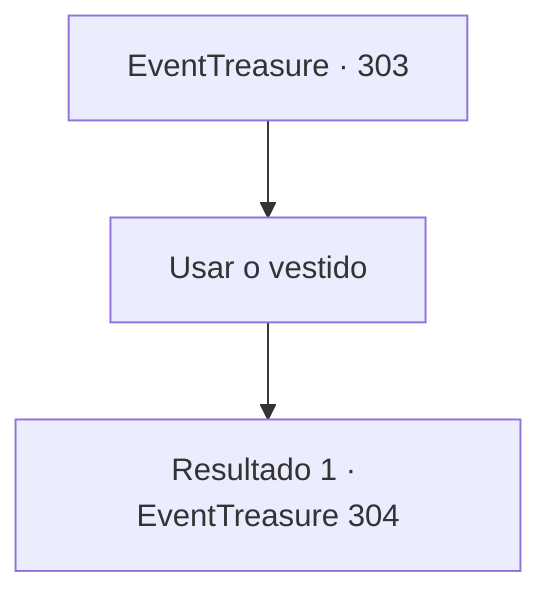

# Eventos de tesouro · 303

[Índice da tabela](index.md) · [Índice geral](../index.md)

ID: `pt:EventTreasure:303` · Fonte: `EventTreasure4` · Versão: 1.2.47.

Mapeamento estático dos arquivos; a disponibilidade e a execução dependem do estado da run.

## Texto do evento

*Sem texto no arquivo.*

## Dados de entrada

```json
{
  "id": 303,
  "grade": 1,
  "place": "",
  "required": ""
}
```

## Mapa das escolhas



## Escolhas e resultados

### Escolha 1

Usar o vestido

Requisitos e outros campos da escolha:

```json
{
  "required": ""
}
```

#### Resultado 1.1

Você desliza no vestido extravagante que Lenia te entrega. Uma vez que você o veste, sua aparência se transforma para parecer exatamente como Lenia. 

 "O que você acha? Ele tem um feitiço de alteração de aparência, então enquanto você o usar, você vai parecer igual a mim. Tudo que você precisa fazer é ir ao baile de máscaras usando isso."

 Cheia de orgulho, Lenia então te entrega uma máscara em forma de raposa que cobre todo o rosto. Enquanto você a aceita, ela tira um pergaminho e te oferece. 

 "Aqui. Você precisa memorizar isso. Caso haja alguma pergunta sobre mim."

 O pergaminho está cheio de todo tipo de informação: relações familiares e amigos de Lenia, formas de expressar intenções com um leque, as últimas tendências na cena social e mais.

Continuação registrada: [Evento 304](0304.md) na mesma tabela.

```json
{
  "required": "",
  "chance": "1",
  "nextEvent": 304,
  "type": 2,
  "reward": ""
}
```

## Referências que chegam a este evento

- [Evento 302 · escolha 1 · resultado 1](0302.md#escolha-1)
