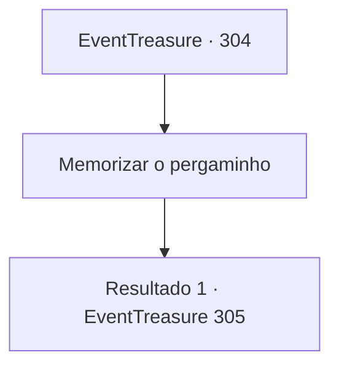

# Eventos de tesouro · 304

[Índice da tabela](index.md) · [Índice geral](../index.md)

ID: `pt:EventTreasure:304` · Fonte: `EventTreasure4` · Versão: 1.2.47.

Mapeamento estático dos arquivos; a disponibilidade e a execução dependem do estado da run.

## Texto do evento

*Sem texto no arquivo.*

## Dados de entrada

```json
{
  "id": 304,
  "grade": 1,
  "place": "",
  "required": ""
}
```

## Mapa das escolhas



## Escolhas e resultados

### Escolha 1

Memorizar o pergaminho

Requisitos e outros campos da escolha:

```json
{
  "required": ""
}
```

#### Resultado 1.1

Você memorizou o conteúdo do pergaminho que ela entregou e praticou sua dança com antecedência com a música que seria tocada no baile de máscaras. Alguns dias depois, o baile de máscaras é realizado na mansão do Conde Hols e você comparece no lugar de Lenia. Depois que a música começa a tocar, um grupo de damas se aproxima para cumprimentá-lo. 

 "Lady Lenia. O que o traz ao baile de máscaras?"

 A mulher à frente do grupo inicia a conversa.

Continuação registrada: [Evento 305](0305.md) na mesma tabela.

```json
{
  "required": "",
  "chance": "1",
  "nextEvent": 305,
  "type": 2,
  "reward": ""
}
```

## Referências que chegam a este evento

- [Evento 303 · escolha 1 · resultado 1](0303.md#escolha-1)
