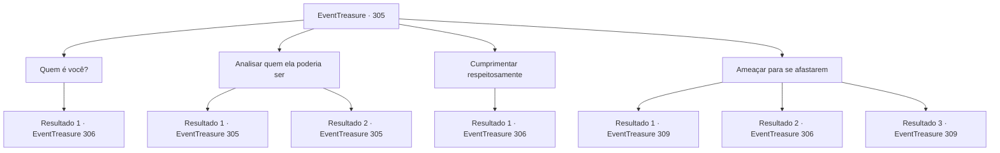

# Eventos de tesouro · 305

[Índice da tabela](index.md) · [Índice geral](../index.md)

ID: `pt:EventTreasure:305` · Fonte: `EventTreasure4` · Versão: 1.2.47.

Mapeamento estático dos arquivos; a disponibilidade e a execução dependem do estado da run.

## Texto do evento

*Sem texto no arquivo.*

## Dados de entrada

```json
{
  "id": 305,
  "grade": 1,
  "place": "",
  "required": ""
}
```

## Mapa das escolhas



## Escolhas e resultados

### Escolha 1

Quem é você?

Requisitos e outros campos da escolha:

```json
{
  "required": ""
}
```

#### Resultado 1.1

A mulher responde à sua pergunta como se se sentisse desprezada, fechando seu leque de uma vez. 

 "Lenia... Você perdeu a memória? Ou está me ignorando de maneira tão grosseira que nem consigo imaginar por ressentimento?"

 Nesse momento, um de seus seguidores finge repreendê-la. 

 "Não seja tão dura com ela, Lady Diasse. De qualquer forma, ela vai fazer papel de ridícula enquanto dança daqui a pouco. Que tal guardar sua zombaria para então~ Ho ho."

 Após as palavras do seguidor, Diasse suspira longamente. 

 "Você está certo. O conde Hols deve estar profundamente preocupado. Especialmente depois que o baile de máscaras terminar esta noite."

 Eles riem e vão encontrar outros nobres. Nesse momento, um nobre se aproxima de você e fala. 

 "Minha querida condessa Hols. Gostaria de dançar uma música comigo?"

 Ele fala com uma voz suave como manteiga, estendendo a mão para você.

Continuação registrada: [Evento 306](0306.md) na mesma tabela.

```json
{
  "required": "",
  "chance": "1",
  "nextEvent": 306,
  "type": 2,
  "reward": ""
}
```

### Escolha 2

Analisar quem ela poderia ser

Requisitos e outros campos da escolha:

```json
{
  "required": "5_555_0"
}
```

#### Resultado 2.1

Rapidamente você escaneia a aparência da mulher e a compara com o conteúdo do pergaminho. Seus olhos afiados, cabelo cacheado, broche roxo em forma de aranha e o anel de ametista em sua mão. A partir disso, você reconhece que ela é 'Diasse' da família duque 'Notte'. De acordo com os registros de Lenia, ela gosta de se gabar de seu conhecimento e riqueza, e sua atitude condescendente em relação à Casa do Conde Hols tem tornado sua relação com Lenia bastante desfavorável.

Continuação registrada: [Evento 305](0305.md) na mesma tabela.

```json
{
  "required": "",
  "chance": "1|0_7_1",
  "nextEvent": 305,
  "type": 0,
  "reward": "5_555_1"
}
```

#### Resultado 2.2

Rapidamente você escaneia a aparência da mulher. No entanto, incapaz de lembrar o conteúdo escrito no pergaminho, você não consegue deduzir sua identidade.

Continuação registrada: [Evento 305](0305.md) na mesma tabela.

```json
{
  "required": "",
  "chance": "14",
  "nextEvent": 305,
  "type": 1,
  "reward": "5_555_2"
}
```

### Escolha 3

Cumprimentar respeitosamente

Requisitos e outros campos da escolha:

```json
{
  "required": ""
}
```

#### Resultado 3.1

Você cumprimentou cortesmente Diasse e seus seguidores. Diante disso, eles abriram os olhos surpresos. 

 "...Suponho que amanhã o sol nascerá no oeste. Não esperava uma saudação tão digna de você."

 Diasse parece genuinamente surpresa, e um seguidor acrescenta. 

 "Sim... sim, de fato. Hehe, estou ansioso para ver a dança que você apresentará hoje, Lady Lenia."

 Eles murmuram entre si e vão encontrar outros nobres. Nesse momento, um nobre se aproxima de você e lhe dirige a palavra. 

 "Minha Lady Condessa Hols. Gostaria de dançar uma música comigo?"

 Ele fala com uma voz suave como manteiga, estendendo a mão para você.

Continuação registrada: [Evento 306](0306.md) na mesma tabela.

```json
{
  "required": "",
  "chance": "1",
  "nextEvent": 306,
  "type": 2,
  "reward": ""
}
```

### Escolha 4

Ameaçar para se afastarem

Requisitos e outros campos da escolha:

```json
{
  "required": ""
}
```

#### Resultado 4.1

Tem ameaçado a Diasse e aos seus seguidores para que parem de te incomodar e se retirem. Diante disso, eles ficaram pálidos e recuaram, alguns colidindo uns com os outros e caindo, o restante se escondendo apressadamente entre outros nobres. Depois disso, por um tempo não houve nobres que te incomodassem. Enquanto bebes vinho e observas os outros dançarem, o Conde Hols se aproxima. 

 "Lenia, você não deveria estar dançando também?"

 Ele não pode mostrar sua raiva, pois está ciente dos outros nobres ao redor, mas você pode perceber que ele está contendo. Parece que ele quer que você mostre suas habilidades para dançar.

Continuação registrada: [Evento 309](0309.md) na mesma tabela.

```json
{
  "required": "21_0_4",
  "chance": "1|0_12_1",
  "nextEvent": 309,
  "type": 0,
  "reward": "5_556_1"
}
```

#### Resultado 4.2

Tem ameaçado a Diasse e seus seguidores para que parem de te incomodar e vão embora. No entanto, sua ameaça não o afeta. Diasse resmunga com desprezo e diz: 

 "Hoje você está agindo ainda mais insolente. O conde Hols deve estar muito preocupado. Especialmente depois que esse baile terminar."

 Nesse momento, um nobre se aproxima de você e fala: 

 "Minha senhora condessa Hols. Gostaria de dançar uma música comigo?"

 Ele fala com uma voz suave como manteiga, estendendo a mão em sua direção.

Continuação registrada: [Evento 306](0306.md) na mesma tabela.

```json
{
  "required": "21_0_4",
  "chance": "12",
  "nextEvent": 306,
  "type": 1,
  "reward": ""
}
```

#### Resultado 4.3

Tem ameaçado a Diasse e aos seus seguidores para que parem de te incomodar e se retirem. Diante disso, eles ficaram pálidos e recuaram, alguns colidindo uns com os outros e caindo, o restante se escondendo apressadamente entre outros nobres. Depois disso, por um tempo não houve nobres que te incomodassem. Enquanto bebes vinho e observas os outros dançarem, o Conde Hols se aproxima. 

 "Lenia, você não deveria estar dançando também?"

 Ele não pode mostrar sua raiva, pois está ciente dos outros nobres ao redor, mas você pode perceber que ele está contendo. Parece que ele quer que você mostre suas habilidades para dançar.

Continuação registrada: [Evento 309](0309.md) na mesma tabela.

```json
{
  "required": "20_0_4",
  "chance": "1",
  "nextEvent": 309,
  "type": 2,
  "reward": "5_556_1"
}
```

## Referências que chegam a este evento

- [Evento 304 · escolha 1 · resultado 1](0304.md#escolha-1)
- [Evento 305 · escolha 2 · resultado 1](0305.md#escolha-2)
- [Evento 305 · escolha 2 · resultado 2](0305.md#escolha-2)
