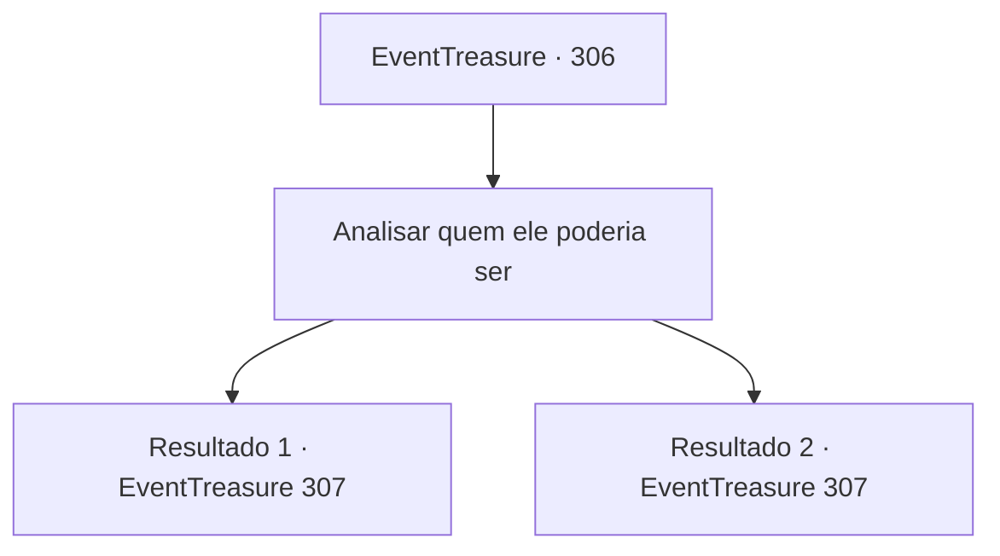

# Eventos de tesouro · 306

[Índice da tabela](index.md) · [Índice geral](../index.md)

ID: `pt:EventTreasure:306` · Fonte: `EventTreasure4` · Versão: 1.2.47.

Mapeamento estático dos arquivos; a disponibilidade e a execução dependem do estado da run.

## Texto do evento

*Sem texto no arquivo.*

## Dados de entrada

```json
{
  "id": 306,
  "grade": 1,
  "place": "",
  "required": ""
}
```

## Mapa das escolhas



## Escolhas e resultados

### Escolha 1

Analisar quem ele poderia ser

Requisitos e outros campos da escolha:

```json
{
  "required": "5_557_0"
}
```

#### Resultado 1.1

Você o avalia rapidamente e lembra quem ele é. É 'Olfin', o filho mais velho do 'Conde Steron', que foi designado como o noivo de Lenia. Lenia aparentemente não gostava muito dele, pois o descreveu como 'insípido' no pergaminho. Olhando de soslaio, você nota o Conde Hols agitando seu copo de vinho em sua direção. Parece que o Conde Hols quer que você dance com Olfin.

Continuação registrada: [Evento 307](0307.md) na mesma tabela.

```json
{
  "required": "",
  "chance": "1|0_7_1",
  "nextEvent": 307,
  "type": 0,
  "reward": "5_557_1"
}
```

#### Resultado 1.2

Você examina cuidadosamente seus traços, tentando lembrar quem poderia ser, mas não importa o quanto você se esforce, não consegue decifrar sua identidade. Um olhar rápido revela Earl Hols agitando seu copo de vinho em sua direção. Parece que o Conde Hols deseja que você dance com esse homem.

Continuação registrada: [Evento 307](0307.md) na mesma tabela.

```json
{
  "required": "",
  "chance": "14",
  "nextEvent": 307,
  "type": 1,
  "reward": "5_557_2"
}
```

## Referências que chegam a este evento

- [Evento 305 · escolha 1 · resultado 1](0305.md#escolha-1)
- [Evento 305 · escolha 3 · resultado 1](0305.md#escolha-3)
- [Evento 305 · escolha 4 · resultado 2](0305.md#escolha-4)
