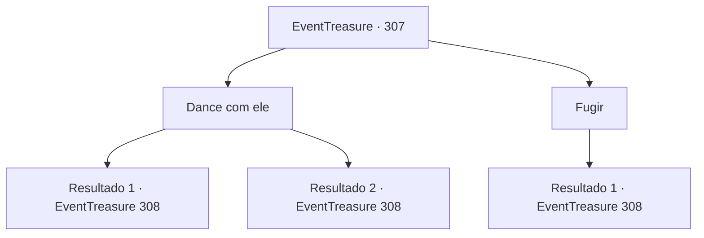

# Eventos de tesouro · 307

[Índice da tabela](index.md) · [Índice geral](../index.md)

ID: `pt:EventTreasure:307` · Fonte: `EventTreasure4` · Versão: 1.2.47.

Mapeamento estático dos arquivos; a disponibilidade e a execução dependem do estado da run.

## Texto do evento

*Sem texto no arquivo.*

## Dados de entrada

```json
{
  "id": 307,
  "grade": 1,
  "place": "",
  "required": ""
}
```

## Mapa das escolhas



## Escolhas e resultados

### Escolha 1

Dance com ele

Requisitos e outros campos da escolha:

```json
{
  "required": ""
}
```

#### Resultado 1.1

Você aceitou o convite dele para dançar. Por um momento, ele parecia surpreso, depois rapidamente segurou sua mão. Você dançou com ele no ritmo da música, e murmúrios de surpresa dos outros nobres encheram o ambiente. Quando sua dança termina, o Conde Hols se aproxima e dá tapinhas em seu ombro. 

 "Por que você tem causado tanto alvoroço quando é tão boa? Sua dança é nada menos que uma obra-prima. Hahaha!"

 Então ele se reclina e se afasta. Durante o resto do dia, você continua dançando com outros nobres. Sua dança digna e encantadora os cativa, e eles não economizam em aplausos fervorosos.

Continuação registrada: [Evento 308](0308.md) na mesma tabela.

```json
{
  "required": "",
  "chance": "1|0_12_1|0_6_1",
  "nextEvent": 308,
  "type": 0,
  "reward": "5_558_1"
}
```

#### Resultado 1.2

Você aceitou o convite dele para dançar. Por um momento, ele pareceu surpreso, depois rapidamente segurou sua mão. Você tenta dançar no ritmo da música, mas seus passos se enrolam. Depois de pisar nos pés dele várias vezes, finalmente a dança termina e os outros nobres reagem como se 'soubessem que isso ia acontecer'. O Conde Hols suspira profundamente e se retira para seu próprio quarto.

Continuação registrada: [Evento 308](0308.md) na mesma tabela.

```json
{
  "required": "",
  "chance": "24",
  "nextEvent": 308,
  "type": 1,
  "reward": "5_558_2"
}
```

### Escolha 2

Fugir

Requisitos e outros campos da escolha:

```json
{
  "required": "5_557_1"
}
```

#### Resultado 2.1

Você imita exatamente o comportamento passado de Lenia. Você recusa o convite para dançar e foge. Os outros nobres reagem como se estivessem esperando por isso. O Conde Hols suspira profundamente e se retira para o seu quarto.

Continuação registrada: [Evento 308](0308.md) na mesma tabela.

```json
{
  "required": "",
  "chance": "1",
  "nextEvent": 308,
  "type": 2,
  "reward": "5_558_2"
}
```

## Referências que chegam a este evento

- [Evento 306 · escolha 1 · resultado 1](0306.md#escolha-1)
- [Evento 306 · escolha 1 · resultado 2](0306.md#escolha-1)
