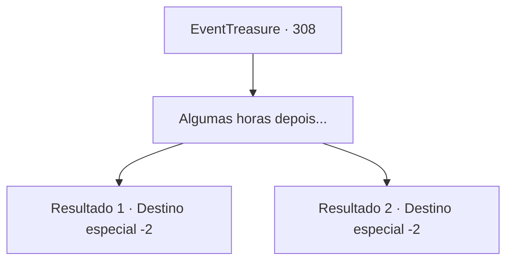

# Eventos de tesouro · 308

[Índice da tabela](index.md) · [Índice geral](../index.md)

ID: `pt:EventTreasure:308` · Fonte: `EventTreasure4` · Versão: 1.2.47.

Mapeamento estático dos arquivos; a disponibilidade e a execução dependem do estado da run.

## Texto do evento

*Sem texto no arquivo.*

## Dados de entrada

```json
{
  "id": 308,
  "grade": 1,
  "place": "",
  "required": ""
}
```

## Mapa das escolhas



## Escolhas e resultados

### Escolha 1

Algumas horas depois...

Requisitos e outros campos da escolha:

```json
{
  "required": ""
}
```

#### Resultado 1.1

Algumas horas depois, depois que os nobres se foram, você encontra Lenia no jardim atrás da mansão. Ela elogia seu esforço. 

 "Uf... Obrigado, eu me diverti muito. Obrigado. Rapidamente tire o vestido e me siga."

 Você tira o vestido mágico e volta à sua forma original. Nesse momento, você sente a presença de alguém atrás de você, e os olhos de Lenia se abrem bem. Quando você se vira, encontra o olhar do Conde Hols. Ele cambaleia, pressionando sua mão grossa contra a testa. 

 "Oh... Meu Deus... Lenia."

 Depois de recuperar o fôlego por um momento, ele solta um tremendo rugido. <link=shake>

 "Siga-me agora mesmo!"

</link> Ele leva sua filha para o quarto dela. Depois de alguns barulhos altos vindo de trás da porta, a porta se abre e Lenia sai. 

 "Ele quer que você também entre."

 Você vai com ela e entra no quarto do Conde. Depois de lavar o rosto várias vezes, Hols abre a boca. 

 "Uf... Certamente, Lenia te enganou. Ainda assim, estou aliviado que a honra de nossa família tenha sido salva em certa medida graças a você."

 Ele aponta para seu servo e te entrega um pouco de ouro. Você aceita e sai da mansão do Conde.

Continuação registrada: [Destino especial `-2`](../destinos-especiais.md).

```json
{
  "required": "5_558_1",
  "chance": "1",
  "nextEvent": -2,
  "type": 2,
  "reward": "27_39_1|0_4_100|0_2_1|5_552_9"
}
```

#### Resultado 1.2

Algumas horas depois, depois que os nobres se foram, você encontra Lenia no jardim atrás da mansão. Ela elogia seu esforço. 

 "Uf... Obrigado(a) a você, eu me diverti muito. Obrigado(a). Rapidamente tire o vestido e me siga."

 Você tira o vestido mágico e volta à sua forma original. Em seguida, devolve o vestido para Lenia. 

 "Aqui. Isso é pelos seus problemas."

 Ela lhe entrega uma bolsa volumosa, e enquanto você a pega, deixa a mansão.

Continuação registrada: [Destino especial `-2`](../destinos-especiais.md).

```json
{
  "required": "5_558_2",
  "chance": "1",
  "nextEvent": -2,
  "type": 2,
  "reward": "5_552_9|0_4_100"
}
```

## Referências que chegam a este evento

- [Evento 307 · escolha 1 · resultado 1](0307.md#escolha-1)
- [Evento 307 · escolha 1 · resultado 2](0307.md#escolha-1)
- [Evento 307 · escolha 2 · resultado 1](0307.md#escolha-2)
- [Evento 309 · escolha 1 · resultado 1](0309.md#escolha-1)
- [Evento 309 · escolha 1 · resultado 2](0309.md#escolha-1)
