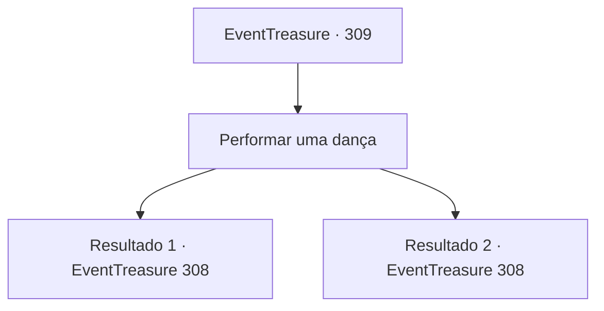

# Eventos de tesouro · 309

[Índice da tabela](index.md) · [Índice geral](../index.md)

ID: `pt:EventTreasure:309` · Fonte: `EventTreasure4` · Versão: 1.2.47.

Mapeamento estático dos arquivos; a disponibilidade e a execução dependem do estado da run.

## Texto do evento

*Sem texto no arquivo.*

## Dados de entrada

```json
{
  "id": 309,
  "grade": 1,
  "place": "",
  "required": ""
}
```

## Mapa das escolhas



## Escolhas e resultados

### Escolha 1

Performar uma dança

Requisitos e outros campos da escolha:

```json
{
  "required": ""
}
```

#### Resultado 1.1

Você mostrou suas habilidades de dança conforme solicitado pelo conde. Você ocupou o centro do palco no salão, dançou no ritmo da música e sua dança elegante e dignificada cativou a atenção de todos os presentes. Pareceu também surpreender os outros nobres, pois murmúrios encheram o ambiente. Quando sua dança termina, o conde Hols se aproxima e dá tapinhas em seu ombro. 

 "Por que você tem causado tanto alvoroço quando é tão bom? Sua dança não é menos que uma obra-prima. Hahaha!"

 Em seguida, ele se reclina e se afasta. Durante o resto do dia, você continua dançando com outros nobres. Sua dança digna e encantadora os cativa, e eles não economizam em aplausos fervorosos.

Continuação registrada: [Evento 308](0308.md) na mesma tabela.

```json
{
  "required": "",
  "chance": "1|0_12_1|0_6_1",
  "nextEvent": 308,
  "type": 0,
  "reward": "5_558_1"
}
```

#### Resultado 1.2

Mostre suas habilidades de dança como o conde solicitou. No entanto, devido ao seu nervosismo, você não consegue realizar uma dança adequada e acaba sendo alvo de zombaria. O conde Hols suspira profundamente e se retira para seu quarto.

Continuação registrada: [Evento 308](0308.md) na mesma tabela.

```json
{
  "required": "",
  "chance": "24",
  "nextEvent": 308,
  "type": 1,
  "reward": "5_558_2"
}
```

## Referências que chegam a este evento

- [Evento 305 · escolha 4 · resultado 1](0305.md#escolha-4)
- [Evento 305 · escolha 4 · resultado 3](0305.md#escolha-4)
