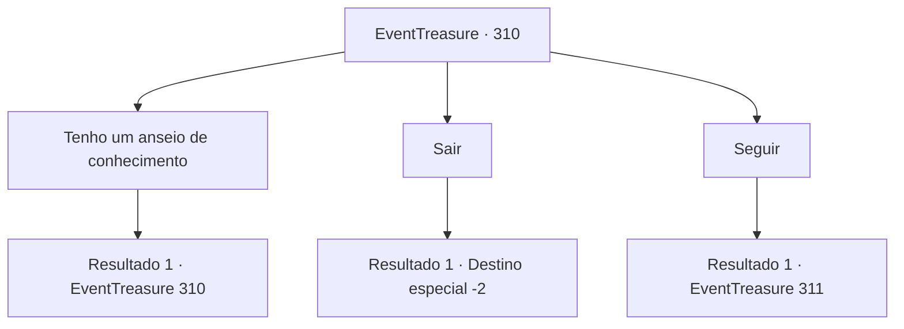

# Eventos de tesouro · 310

[Índice da tabela](index.md) · [Índice geral](../index.md)

ID: `pt:EventTreasure:310` · Fonte: `EventTreasure4` · Versão: 1.2.47.

Mapeamento estático dos arquivos; a disponibilidade e a execução dependem do estado da run.

## Texto do evento

Ao escalar a montanha, você faz uma pausa e se senta em um penhasco com vista para uma córrego violento. Embora ansioso, seu crescimento parece mais lento do que o esperado. Só então, uma voz calma vem atrás de você. 

 "Dizem que um problema compartilhado é um problema dividido pela metade. Você poderia me dizer o que está pensando?"

 Aproximando-se de você está um monge idoso. Seu rosto traz as marcas do tempo e a sabedoria é evidente em seus olhos.

## Dados de entrada

```json
{
  "id": 310,
  "grade": 2,
  "place": "",
  "required": "1_2_50|5_563_0|26_16_1"
}
```

## Mapa das escolhas



## Escolhas e resultados

### Escolha 1

Tenho um anseio de conhecimento

Requisitos e outros campos da escolha:

```json
{
  "required": "5_564_0"
}
```

#### Resultado 1.1

Você confiou seus problemas ao monge. Ele ouve sua história em silêncio, então sugere cuidadosamente, 

 "Há um templo não muito longe daqui. É um lugar onde monges como eu se esforçam para alcançar a iluminação. Você gostaria de vir comigo, se estiver tudo bem?"


Continuação registrada: [Evento 310](0310.md) na mesma tabela.

```json
{
  "required": "",
  "chance": "1",
  "nextEvent": 310,
  "type": 2,
  "reward": "5_564_1|5_563_1"
}
```

### Escolha 2

Sair

Requisitos e outros campos da escolha:

```json
{
  "required": ""
}
```

#### Resultado 2.1

Você agita sua mão, indicando ao monge que ele vá embora. Sem dizer mais uma palavra, ele sai silenciosamente.

Continuação registrada: [Destino especial `-2`](../destinos-especiais.md).

```json
{
  "required": "",
  "chance": "1",
  "nextEvent": -2,
  "type": 2,
  "reward": "5_563_9"
}
```

### Escolha 3

Seguir

Requisitos e outros campos da escolha:

```json
{
  "required": "5_564_1"
}
```

#### Resultado 3.1

Siga o monge, subindo a montanha rochosa e entrando no mosteiro construído no topo. |drawing_hidePublius| Conhecido como 'Mosteiro da Ascética', este lugar é cercado por paredes de penhasco como uma fortaleza. Abriga várias instalações, incluindo um campo de treinamento, e os monges vivem e praticam aqui. 

 "Escolha seu próprio caminho de disciplina e quanto tempo deseja segui-lo."

 Ele diz. Você passeia, observando os outros monges. Alguns estão lutando na arena, outros estão decifrando e transcrevendo escritos antigos. Outros ainda estão meditando sob uma cachoeira.

Continuação registrada: [Evento 311](0311.md) na mesma tabela.

```json
{
  "required": "",
  "chance": "1",
  "nextEvent": 311,
  "type": 2,
  "reward": ""
}
```

## Referências que chegam a este evento

- [Evento 310 · escolha 1 · resultado 1](0310.md#escolha-1)
