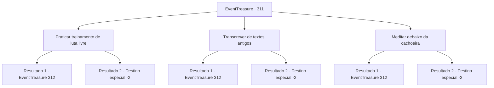

# Eventos de tesouro · 311

[Índice da tabela](index.md) · [Índice geral](../index.md)

ID: `pt:EventTreasure:311` · Fonte: `EventTreasure4` · Versão: 1.2.47.

Mapeamento estático dos arquivos; a disponibilidade e a execução dependem do estado da run.

## Texto do evento

*Sem texto no arquivo.*

## Dados de entrada

```json
{
  "id": 311,
  "grade": 1,
  "place": "",
  "required": ""
}
```

## Mapa das escolhas



## Escolhas e resultados

### Escolha 1

Praticar treinamento de luta livre

Requisitos e outros campos da escolha:

```json
{
  "required": ""
}
```

#### Resultado 1.1

Você lutou no areeiro com os monges todos os dias. Depois de um tempo indeterminável, o monge de meia-idade que você conheceu antes vem te procurar. Ele observa sua condição e então sorri amplamente, dizendo: 

 "Eu estive te observando. Aos meus olhos, você tem o potencial para ascender a um reino superior. Siga-me."

 Você o segue até uma porta de pedra escondida nas profundezas da montanha. O monge coloca a mão na porta de pedra, e ela se abre em silêncio. Conforme a porta de pedra se abre, uma escuridão absoluta que não permite que você veja nem mesmo um centímetro à frente te dá as boas-vindas.

Continuação registrada: [Evento 312](0312.md) na mesma tabela.

```json
{
  "required": "",
  "chance": "1|0_5_1|0_6_1",
  "nextEvent": 312,
  "type": 0,
  "reward": "0_5_1|0_6_1"
}
```

#### Resultado 1.2

Você lutou no ringue com os monges todos os dias. Após um tempo indeterminável, você sente que seu corpo se desenvolveu ainda mais. Portanto, você se despede dos monges e abandona o monastério.

Continuação registrada: [Destino especial `-2`](../destinos-especiais.md).

```json
{
  "required": "",
  "chance": "18",
  "nextEvent": -2,
  "type": 1,
  "reward": "5_563_9"
}
```

### Escolha 2

Transcrever de textos antigos

Requisitos e outros campos da escolha:

```json
{
  "required": ""
}
```

#### Resultado 2.1

Decodifica e transcreve textos antigos com os monges todos os dias. Após um tempo indeterminável, o monge de meia-idade que você conheceu antes vem te procurar. Ele observa sua condição e então sorri amplamente, dizendo: 

 "Eu estive te observando. Aos meus olhos, você tem o potencial para ascender a um reino superior. Siga-me."

 Você o segue até uma porta de pedra escondida nas profundezas da montanha. O monge coloca a mão na porta de pedra, e ela se abre silenciosamente. Conforme a porta de pedra se abre, uma escuridão absoluta que não permite que você veja nem mesmo um centímetro à frente te dá as boas-vindas.

Continuação registrada: [Evento 312](0312.md) na mesma tabela.

```json
{
  "required": "",
  "chance": "1|0_7_1|0_12_1",
  "nextEvent": 312,
  "type": 0,
  "reward": "0_7_1|0_12_1"
}
```

#### Resultado 2.2

Decodificas e transcreves textos antigos com os monges todos os dias. Após um tempo indeterminável, sentes que teus sentidos se expandem. Portanto, te despedes dos monges e abandonas o monastério.

Continuação registrada: [Destino especial `-2`](../destinos-especiais.md).

```json
{
  "required": "",
  "chance": "18",
  "nextEvent": -2,
  "type": 1,
  "reward": "5_563_9"
}
```

### Escolha 3

Meditar debaixo da cachoeira

Requisitos e outros campos da escolha:

```json
{
  "required": ""
}
```

#### Resultado 3.1

Você meditava diariamente com os monges, sentado debaixo de uma cascata. Após um tempo indeterminável, o monge de meia-idade que você conheceu antes vem te procurar. Ele observa sua condição e então sorri amplamente, dizendo: 

 "Eu estive te observando. Aos meus olhos, você tem o potencial de ascender a um reino superior. Siga-me."

 Você o segue até uma porta de pedra escondida nas profundezas da montanha. O monge coloca sua mão na porta de pedra, e ela se abre silenciosamente. Conforme a porta de pedra se abre, uma escuridão absoluta que não permite que você veja nem mesmo um centímetro à frente te dá as boas-vindas.

Continuação registrada: [Evento 312](0312.md) na mesma tabela.

```json
{
  "required": "",
  "chance": "1|0_13_1|0_14_1",
  "nextEvent": 312,
  "type": 0,
  "reward": "0_13_1|0_14_1"
}
```

#### Resultado 3.2

Você meditou diariamente com os monges, sentado debaixo de uma cascata. Após um tempo indeterminável, você sente como se seu corpo e mente estivessem sendo refinados. Portanto, você se despede dos monges e abandona o monastério.

Continuação registrada: [Destino especial `-2`](../destinos-especiais.md).

```json
{
  "required": "",
  "chance": "18",
  "nextEvent": -2,
  "type": 1,
  "reward": "5_563_9"
}
```

## Referências que chegam a este evento

- [Evento 310 · escolha 3 · resultado 1](0310.md#escolha-3)
