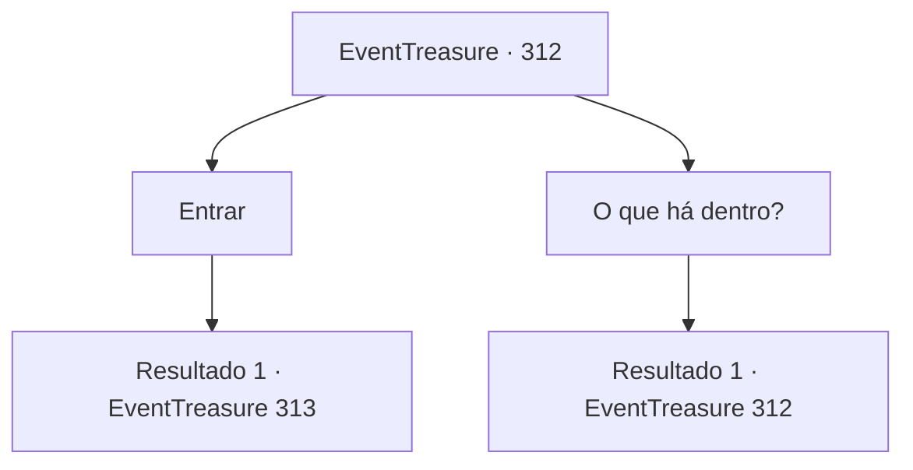

# Eventos de tesouro · 312

[Índice da tabela](index.md) · [Índice geral](../index.md)

ID: `pt:EventTreasure:312` · Fonte: `EventTreasure4` · Versão: 1.2.47.

Mapeamento estático dos arquivos; a disponibilidade e a execução dependem do estado da run.

## Texto do evento

*Sem texto no arquivo.*

## Dados de entrada

```json
{
  "id": 312,
  "grade": 1,
  "place": "",
  "required": ""
}
```

## Mapa das escolhas



## Escolhas e resultados

### Escolha 1

Entrar

Requisitos e outros campos da escolha:

```json
{
  "required": ""
}
```

#### Resultado 1.1

Você entra em uma caverna escura. Na caverna quase sem luz, você se depara com um espelho em cascata. A cascata feita de espelho reflete uma quantidade mínima de luz, projetando seu reflexo na escuridão. Enquanto você se olha nele, o reflexo de você no espelho abre a boca. 

 "Renda-se... Seu objetivo é inalcançável. Você será derrotado sem esperança e ninguém se lembrará de você."


Continuação registrada: [Evento 313](0313.md) na mesma tabela.

```json
{
  "required": "",
  "chance": "1",
  "nextEvent": 313,
  "type": 2,
  "reward": ""
}
```

### Escolha 2

O que há dentro?

Requisitos e outros campos da escolha:

```json
{
  "required": "5_565_0"
}
```

#### Resultado 2.1

Você pergunta ao monge o que há nessa escuridão. O monge responde que ele também não sabe. 

 "Bem... eu também não posso saber. No entanto, algo aparecerá que pode te ajudar a superar seus limites."


Continuação registrada: [Evento 312](0312.md) na mesma tabela.

```json
{
  "required": "",
  "chance": "1",
  "nextEvent": 312,
  "type": 2,
  "reward": "5_565_1"
}
```

## Referências que chegam a este evento

- [Evento 311 · escolha 1 · resultado 1](0311.md#escolha-1)
- [Evento 311 · escolha 2 · resultado 1](0311.md#escolha-2)
- [Evento 311 · escolha 3 · resultado 1](0311.md#escolha-3)
- [Evento 312 · escolha 2 · resultado 1](0312.md#escolha-2)
