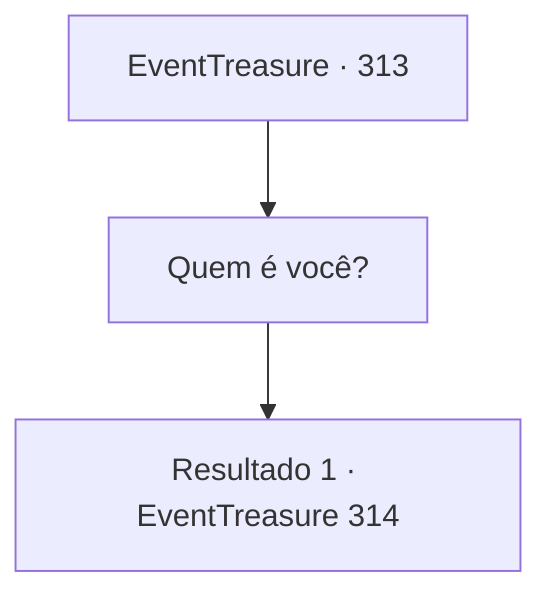

# Eventos de tesouro · 313

[Índice da tabela](index.md) · [Índice geral](../index.md)

ID: `pt:EventTreasure:313` · Fonte: `EventTreasure4` · Versão: 1.2.47.

Mapeamento estático dos arquivos; a disponibilidade e a execução dependem do estado da run.

## Texto do evento

*Sem texto no arquivo.*

## Dados de entrada

```json
{
  "id": 313,
  "grade": 1,
  "place": "",
  "required": ""
}
```

## Mapa das escolhas



## Escolhas e resultados

### Escolha 1

Quem é você?

Requisitos e outros campos da escolha:

```json
{
  "required": ""
}
```

#### Resultado 1.1

Você pergunta ao você no espelho. Então, ele te olha e ri. 

 "Hahaha! Quem sou eu? Sou você. Falando estritamente... sou o seu futuro. Acredite em mim. Porque o que eu digo é verdade."

 O você no espelho faz um gesto para que você se aproxime. 

 "Aproxime-se. Vou te mostrar o seu futuro."


Continuação registrada: [Evento 314](0314.md) na mesma tabela.

```json
{
  "required": "",
  "chance": "1",
  "nextEvent": 314,
  "type": 2,
  "reward": ""
}
```

## Referências que chegam a este evento

- [Evento 312 · escolha 1 · resultado 1](0312.md#escolha-1)
