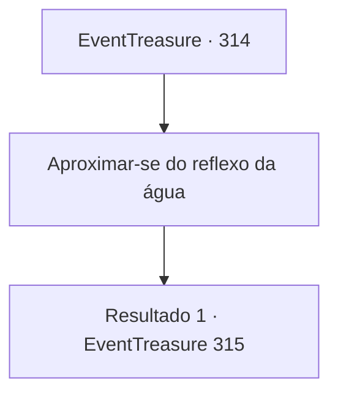

# Eventos de tesouro · 314

[Índice da tabela](index.md) · [Índice geral](../index.md)

ID: `pt:EventTreasure:314` · Fonte: `EventTreasure4` · Versão: 1.2.47.

Mapeamento estático dos arquivos; a disponibilidade e a execução dependem do estado da run.

## Texto do evento

*Sem texto no arquivo.*

## Dados de entrada

```json
{
  "id": 314,
  "grade": 1,
  "place": "",
  "required": ""
}
```

## Mapa das escolhas



## Escolhas e resultados

### Escolha 1

Aproximar-se do reflexo da água

Requisitos e outros campos da escolha:

```json
{
  "required": ""
}
```

#### Resultado 1.1

Você se aproxima da cachoeira. Então, o seu reflexo na água estende a mão e puxa você para dentro da cachoeira. Num piscar de olhos, você é sugado para dentro da água e se depara com figuras idênticas a você. No reflexo, inúmeros 'você' estão presentes. Eles o encaram com desprezo e falam: 

 "Você... seria melhor morrer aqui. Esse seria o seu futuro mais feliz."


Continuação registrada: [Evento 315](0315.md) na mesma tabela.

```json
{
  "required": "",
  "chance": "1",
  "nextEvent": 315,
  "type": 2,
  "reward": ""
}
```

## Referências que chegam a este evento

- [Evento 313 · escolha 1 · resultado 1](0313.md#escolha-1)
