# Eventos de tesouro · 315

[Índice da tabela](index.md) · [Índice geral](../index.md)

ID: `pt:EventTreasure:315` · Fonte: `EventTreasure4` · Versão: 1.2.47.

Mapeamento estático dos arquivos; a disponibilidade e a execução dependem do estado da run.

## Texto do evento

*Sem texto no arquivo.*

## Dados de entrada

```json
{
  "id": 315,
  "grade": 1,
  "place": "",
  "required": ""
}
```

## Mapa das escolhas

```mermaid
flowchart TD
  E["EventTreasure · 315"]
  C0["Me deixe sair"]
  E --> C0
  R0_0["Resultado 1 · EventTreasure 315"]
  C0 --> R0_0
  C1["Atacar os outros &#x27;eus&#x27;"]
  E --> C1
  R1_0["Resultado 1 · EventTreasure 316"]
  C1 --> R1_0
  R1_1["Resultado 2 · Destino especial -3"]
  C1 --> R1_1
```



## Escolhas e resultados

### Escolha 1

Me deixe sair

Requisitos e outros campos da escolha:

```json
{
  "required": "5_566_0"
}
```

#### Resultado 1.1

Diante do seu pedido, as inúmeras versões de você mostram diferentes reações. Algumas zombam, algumas gritam, algumas riem e algumas fazem ouvidos surdos. Então, alguém fala. 

 "A única forma de sair daqui é nos matarmos todos."


Continuação registrada: [Evento 315](0315.md) na mesma tabela.

```json
{
  "required": "",
  "chance": "1",
  "nextEvent": 315,
  "type": 2,
  "reward": "5_566_1"
}
```

### Escolha 2

Atacar os outros 'eus'

Requisitos e outros campos da escolha:

```json
{
  "required": ""
}
```

#### Resultado 2.1

Você se aproxima dos outros 'você' e os ataca. Alguns fogem enquanto outros se defendem. Mas eles são infinitos, e não importa quantos você mate, eles não desaparecem. Em vez disso, quanto mais você ataca, mais feridas acumula. No final, você se esgota e colapsa.

Continuação registrada: [Evento 316](0316.md) na mesma tabela.

```json
{
  "required": "1_0_2",
  "chance": "1",
  "nextEvent": 316,
  "type": 2,
  "reward": ""
}
```

#### Resultado 2.2

Você se aproxima dos outros 'você' e os ataca. Alguns fogem enquanto outros contra-atacam. Mas eles são intermináveis, e não importa quantos você mate, eles não desaparecem. Em vez disso, quanto mais você ataca, mais feridas acumula. No final, você se esgota, desmorona e perde a consciência.

Continuação registrada: [Destino especial `-3`](../destinos-especiais.md).

```json
{
  "required": "2_0_2",
  "chance": "1",
  "nextEvent": -3,
  "type": 2,
  "reward": "0_0_-1"
}
```

## Referências que chegam a este evento

- [Evento 314 · escolha 1 · resultado 1](0314.md#escolha-1)
- [Evento 315 · escolha 1 · resultado 1](0315.md#escolha-1)
