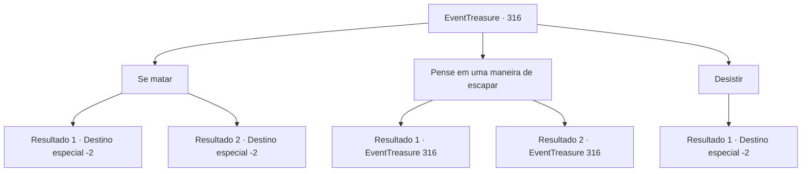

# Eventos de tesouro · 316

[Índice da tabela](index.md) · [Índice geral](../index.md)

ID: `pt:EventTreasure:316` · Fonte: `EventTreasure4` · Versão: 1.2.47.

Mapeamento estático dos arquivos; a disponibilidade e a execução dependem do estado da run.

## Texto do evento

*Sem texto no arquivo.*

## Dados de entrada

```json
{
  "id": 316,
  "grade": 1,
  "place": "",
  "required": ""
}
```

## Mapa das escolhas



## Escolhas e resultados

### Escolha 1

Se matar

Requisitos e outros campos da escolha:

```json
{
  "required": "5_567_1"
}
```

#### Resultado 1.1

Você pegou uma espada de outra versão de si mesmo. Em seguida, você se apunhalou no estômago com ela. Uma grande rachadura apareceu no mundo do espelho e inúmeras versões de você soltaram um grito. Pouco depois, o espelho se quebrou e você perdeu a consciência enquanto caía na escuridão infinita. 

 Momentos depois, quando você abre os olhos, você percebe que de alguma forma voltou para a porta de pedra gigante. O velho monge que te guiou estende a mão para ajudá-lo a se levantar. 

 "Na verdade... você superou a si mesmo. Bem feito. Supere qualquer obstáculo que apareça em seu caminho."

 Você segue o guia do velho monge e sai do monastério. E então, você se despede.

Continuação registrada: [Destino especial `-2`](../destinos-especiais.md).

```json
{
  "required": "",
  "chance": "1|0_14_1",
  "nextEvent": -2,
  "type": 0,
  "reward": "5_563_9|27_40_1"
}
```

#### Resultado 1.2

Tinhas uma hipótese, mas não tiveste coragem de te magoares. Finalmente, desistes de escapar e deitas-te no chão. E quando fechas os olhos e os voltas a abrir, encontras-te novamente em frente à porta de pedra gigante. O velho monge que te guia estende a mão para te ajudar a levantar. 

 "Tiveste um momento difícil. É uma pena, mas é hora de dizer adeus."

 Segues o guia do velho monge e sais do mosteiro. E depois, dás-lhe a tua despedida.

Continuação registrada: [Destino especial `-2`](../destinos-especiais.md).

```json
{
  "required": "",
  "chance": "14",
  "nextEvent": -2,
  "type": 1,
  "reward": "5_563_9"
}
```

### Escolha 2

Pense em uma maneira de escapar

Requisitos e outros campos da escolha:

```json
{
  "required": "5_567_0"
}
```

#### Resultado 2.1

Você contempla como escapar. Quanto mais você ataca 'eles', mais feridas você sofre. Então, uma ideia vem à sua mente, se atacar a si mesmo te machuca, talvez se atacar poderia machucá-los em seu lugar.

Continuação registrada: [Evento 316](0316.md) na mesma tabela.

```json
{
  "required": "",
  "chance": "1|0_14_1|0_7_1",
  "nextEvent": 316,
  "type": 0,
  "reward": "5_567_1"
}
```

#### Resultado 2.2

Você contempla como escapar. No entanto, não importa o quanto você ataque, parece não afetá-los e, pelo contrário, suas feridas apenas aumentam. A perspectiva de eliminá-los todos parece pouco provável.

Continuação registrada: [Evento 316](0316.md) na mesma tabela.

```json
{
  "required": "",
  "chance": "14",
  "nextEvent": 316,
  "type": 1,
  "reward": "5_567_2"
}
```

### Escolha 3

Desistir

Requisitos e outros campos da escolha:

```json
{
  "required": "5_567_2"
}
```

#### Resultado 3.1

Você desiste de escapar e deita no chão. E quando você fecha os olhos e os abre novamente, você se encontra novamente em frente à porta de pedra gigante. O velho monge que te guia estende a mão para te ajudar a levantar. 

 "Você teve um momento difícil. É uma pena, mas é hora de dizer adeus."

 Você segue o guia do velho monge e sai do monastério. E então, você se despede.

Continuação registrada: [Destino especial `-2`](../destinos-especiais.md).

```json
{
  "required": "",
  "chance": "1",
  "nextEvent": -2,
  "type": 2,
  "reward": "5_548_9"
}
```

## Referências que chegam a este evento

- [Evento 315 · escolha 2 · resultado 1](0315.md#escolha-2)
- [Evento 316 · escolha 2 · resultado 1](0316.md#escolha-2)
- [Evento 316 · escolha 2 · resultado 2](0316.md#escolha-2)
