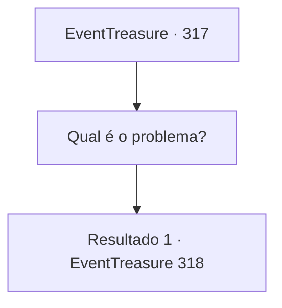

# Eventos de tesouro · 317

[Índice da tabela](index.md) · [Índice geral](../index.md)

ID: `pt:EventTreasure:317` · Fonte: `EventTreasure4` · Versão: 1.2.47.

Mapeamento estático dos arquivos; a disponibilidade e a execução dependem do estado da run.

## Texto do evento

Você encontra um fazendeiro montado em um burro. No burro, parece haver cevada que acabou de ser colhida. Ele olha para você, desce do burro e começa uma conversa amigável. 

 "Prazer em conhecê-lo. Você parece um aventureiro, estou certo? Ah, não precisa responder. Eu também já fui um aventureiro, então posso dizer pela aparência."


## Dados de entrada

```json
{
  "id": 317,
  "grade": 2,
  "place": "",
  "required": "1_2_75|5_568_0|26_17_1"
}
```

## Mapa das escolhas



## Escolhas e resultados

### Escolha 1

Qual é o problema?

Requisitos e outros campos da escolha:

```json
{
  "required": ""
}
```

#### Resultado 1.1

Em resposta à sua pergunta, ele mencionou casualmente que estava apenas lembrando do seu passado e começou a conversa. 

 "Desculpe se te incomodei. Eu estava apenas perdido em memórias antigas. Me chamo Oliger. Se você não se importar, gostaria de te convidar para jantar. O que você acha?"


Continuação registrada: [Evento 318](0318.md) na mesma tabela.

```json
{
  "required": "",
  "chance": "1",
  "nextEvent": 318,
  "type": 2,
  "reward": "5_568_1"
}
```

## Referências que chegam a este evento

Nenhum `nextEvent` positivo da mesma tabela aponta para este nó. Isso não prova que seja inacessível: sorteio e estado de história podem selecioná-lo.

