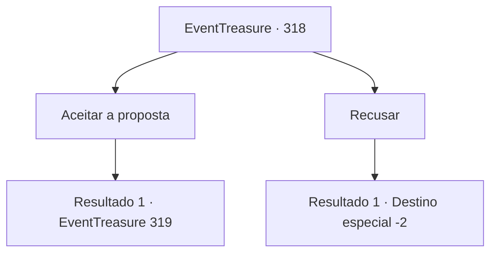

# Eventos de tesouro · 318

[Índice da tabela](index.md) · [Índice geral](../index.md)

ID: `pt:EventTreasure:318` · Fonte: `EventTreasure4` · Versão: 1.2.47.

Mapeamento estático dos arquivos; a disponibilidade e a execução dependem do estado da run.

## Texto do evento

*Sem texto no arquivo.*

## Dados de entrada

```json
{
  "id": 318,
  "grade": 1,
  "place": "",
  "required": ""
}
```

## Mapa das escolhas



## Escolhas e resultados

### Escolha 1

Aceitar a proposta

Requisitos e outros campos da escolha:

```json
{
  "required": ""
}
```

#### Resultado 1.1

Você aceitou a oferta do fazendeiro e dirigiu-se para a casa dele. Localizada ao lado de um campo de cevada, a casa dele era uma pequena cabana onde parecia viver sozinho. Ele serviu pão de centeio, sopa de cogumelos e cerveja na mesa. 

 "Eu não preparei muito, mas por favor coma."

 Você compartilha o jantar com ele. Depois de algumas cervejas, o fazendeiro começa a compartilhar sua história. 

 "...Era uma vez, eu realmente pensei que era um aventureiro. Eu fiz um nome na grande cidade depois de deixar esta pequena cidade. Quer dizer, antes de acabar assim."

 Ele levanta o braço direito para te mostrar. Onde deveria haver uma mão, não há nada desde o pulso para baixo.

Continuação registrada: [Evento 319](0319.md) na mesma tabela.

```json
{
  "required": "",
  "chance": "1",
  "nextEvent": 319,
  "type": 2,
  "reward": "0_0_1"
}
```

### Escolha 2

Recusar

Requisitos e outros campos da escolha:

```json
{
  "required": ""
}
```

#### Resultado 2.1

Você rejeita a oferta do fazendeiro. Ele te assegura que não irá te incomodar mais, e se afasta tranquilamente montado em seu burro.

Continuação registrada: [Destino especial `-2`](../destinos-especiais.md).

```json
{
  "required": "",
  "chance": "1",
  "nextEvent": -2,
  "type": 2,
  "reward": "5_568_9"
}
```

## Referências que chegam a este evento

- [Evento 317 · escolha 1 · resultado 1](0317.md#escolha-1)
