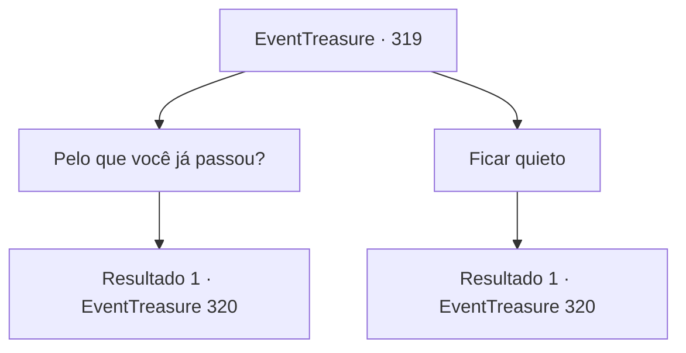

# Eventos de tesouro · 319

[Índice da tabela](index.md) · [Índice geral](../index.md)

ID: `pt:EventTreasure:319` · Fonte: `EventTreasure4` · Versão: 1.2.47.

Mapeamento estático dos arquivos; a disponibilidade e a execução dependem do estado da run.

## Texto do evento

*Sem texto no arquivo.*

## Dados de entrada

```json
{
  "id": 319,
  "grade": 1,
  "place": "",
  "required": ""
}
```

## Mapa das escolhas



## Escolhas e resultados

### Escolha 1

Pelo que você já passou?

Requisitos e outros campos da escolha:

```json
{
  "required": ""
}
```

#### Resultado 1.1

O fazendeiro responde com uma risada aparentemente jovial. 

 "Bem... acabei de fazer algo que não me convém. Estava cheio de orgulho, confiando no meu insignificante talento quando era jovem. Este é o preço que paguei."

 Ele diz que encontrou um dragão vermelho durante suas aventuras, e no final da luta com ele, perdeu sua mão direita e fugiu. 

 "Você já sentiu uma parede? Uma parede que você não pode superar, não importa o que faça."

 Ele disse que esse dragão se sentia como uma parede para ele.

Continuação registrada: [Evento 320](0320.md) na mesma tabela.

```json
{
  "required": "",
  "chance": "1",
  "nextEvent": 320,
  "type": 2,
  "reward": ""
}
```

### Escolha 2

Ficar quieto

Requisitos e outros campos da escolha:

```json
{
  "required": ""
}
```

#### Resultado 2.1

Ele diz que encontrou um dragão vermelho durante suas aventuras, e no final da luta com ele, perdeu sua mão direita e fugiu. 

 "Você já sentiu uma parede? Uma parede que você não pode superar, não importa o que faça."

 Ele disse que esse dragão se sentia como uma parede para ele.

Continuação registrada: [Evento 320](0320.md) na mesma tabela.

```json
{
  "required": "",
  "chance": "1",
  "nextEvent": 320,
  "type": 2,
  "reward": ""
}
```

## Referências que chegam a este evento

- [Evento 318 · escolha 1 · resultado 1](0318.md#escolha-1)
