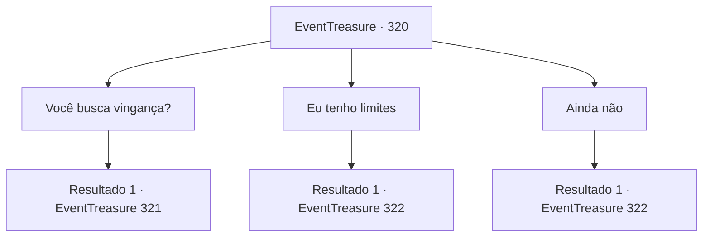

# Eventos de tesouro · 320

[Índice da tabela](index.md) · [Índice geral](../index.md)

ID: `pt:EventTreasure:320` · Fonte: `EventTreasure4` · Versão: 1.2.47.

Mapeamento estático dos arquivos; a disponibilidade e a execução dependem do estado da run.

## Texto do evento

*Sem texto no arquivo.*

## Dados de entrada

```json
{
  "id": 320,
  "grade": 1,
  "place": "",
  "required": ""
}
```

## Mapa das escolhas



## Escolhas e resultados

### Escolha 1

Você busca vingança?

Requisitos e outros campos da escolha:

```json
{
  "required": ""
}
```

#### Resultado 1.1

Em resposta à sua pergunta, o fazendeiro refletiu por um momento antes de falar. 

 "Não... Não. Um... Claro, seria bom se alguém me vingasse, mas isso é pedir demais..."

 Sua voz desapareceu. Então ele deu outro gole na cerveja antes de continuar. 

 "Você sabe em seu coração, não é? Seu crescimento está chegando ao limite. Essa criatura... é difícil de lidar. Não se preocupe com pensamentos inúteis e apenas tome outro gole."


Continuação registrada: [Evento 321](0321.md) na mesma tabela.

```json
{
  "required": "",
  "chance": "1",
  "nextEvent": 321,
  "type": 2,
  "reward": ""
}
```

### Escolha 2

Eu tenho limites

Requisitos e outros campos da escolha:

```json
{
  "required": ""
}
```

#### Resultado 2.1

Em resposta às suas palavras, o fazendeiro assente com a cabeça e fala. 

 "É verdade. Suponho que agora possas ser chamado de adulto... É preciso se machucar, experimentar desespero, só então pode-se realmente se tornar um adulto. Vamos tomar uma bebida entre adultos. Aqui, pegue isso."

 O fazendeiro despeja a bebida com um sorriso e a bebe de uma só vez.

Continuação registrada: [Evento 322](0322.md) na mesma tabela.

```json
{
  "required": "",
  "chance": "1",
  "nextEvent": 322,
  "type": 2,
  "reward": ""
}
```

### Escolha 3

Ainda não

Requisitos e outros campos da escolha:

```json
{
  "required": ""
}
```

#### Resultado 3.1

Em resposta às suas palavras, o fazendeiro ri e fala. 

 "Então você ainda é uma criança, não é? Você conhece o 'Peter'? Ele é a criança eterna no mundo espiritual. Não é realmente invejável? Eu me desgastei assim..."

 O fazendeiro despeja a bebida com um sorriso e a bebe de uma só vez.

Continuação registrada: [Evento 322](0322.md) na mesma tabela.

```json
{
  "required": "",
  "chance": "1",
  "nextEvent": 322,
  "type": 2,
  "reward": ""
}
```

## Referências que chegam a este evento

- [Evento 319 · escolha 1 · resultado 1](0319.md#escolha-1)
- [Evento 319 · escolha 2 · resultado 1](0319.md#escolha-2)
