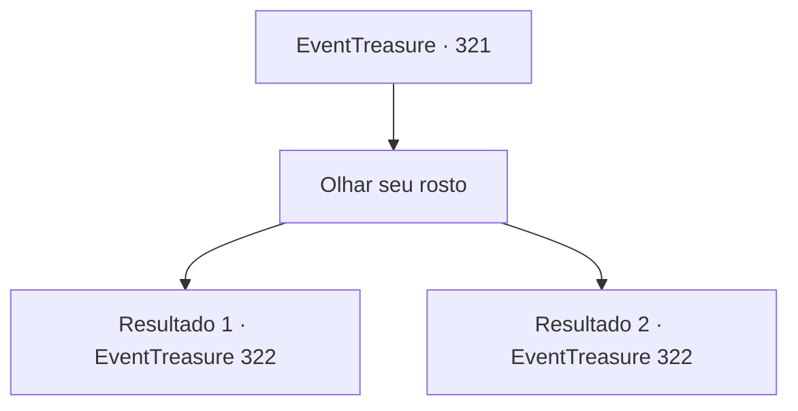

# Eventos de tesouro · 321

[Índice da tabela](index.md) · [Índice geral](../index.md)

ID: `pt:EventTreasure:321` · Fonte: `EventTreasure4` · Versão: 1.2.47.

Mapeamento estático dos arquivos; a disponibilidade e a execução dependem do estado da run.

## Texto do evento

*Sem texto no arquivo.*

## Dados de entrada

```json
{
  "id": 321,
  "grade": 1,
  "place": "",
  "required": ""
}
```

## Mapa das escolhas



## Escolhas e resultados

### Escolha 1

Olhar seu rosto

Requisitos e outros campos da escolha:

```json
{
  "required": ""
}
```

#### Resultado 1.1

Você observa o rosto do fazendeiro beberrão. Agora ele sorri com o rosto avermelhado, dizendo que o passado não significa nada para ele. No entanto, você nota que no fundo de seu coração, ele nutriu um desejo de vingança.

Continuação registrada: [Evento 322](0322.md) na mesma tabela.

```json
{
  "required": "",
  "chance": "1|0_14_1",
  "nextEvent": 322,
  "type": 0,
  "reward": ""
}
```

#### Resultado 1.2

Observas o rosto do fazendeiro beberrão. Agora ele sorri com o rosto avermelhado, dizendo que o passado não significa nada para ele. 

 "Vamos. Ele não sabe quando esfria. Por favor, beba agora."


Continuação registrada: [Evento 322](0322.md) na mesma tabela.

```json
{
  "required": "",
  "chance": "10",
  "nextEvent": 322,
  "type": 1,
  "reward": ""
}
```

## Referências que chegam a este evento

- [Evento 320 · escolha 1 · resultado 1](0320.md#escolha-1)
