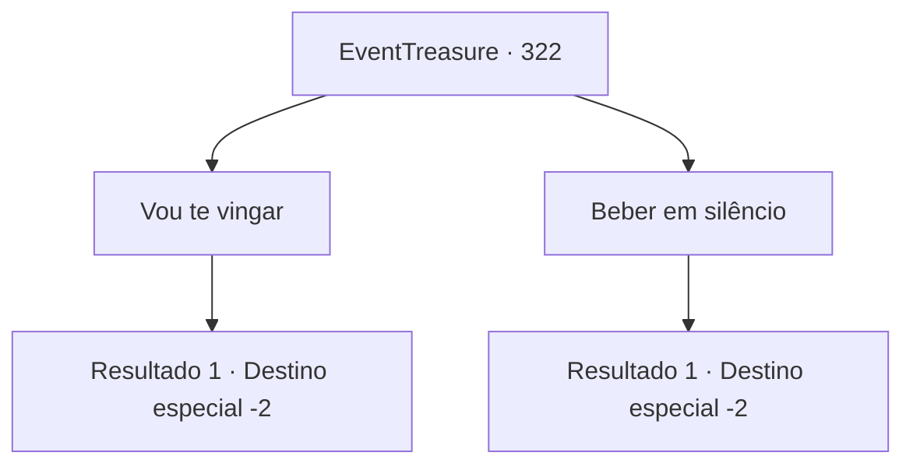

# Eventos de tesouro · 322

[Índice da tabela](index.md) · [Índice geral](../index.md)

ID: `pt:EventTreasure:322` · Fonte: `EventTreasure4` · Versão: 1.2.47.

Mapeamento estático dos arquivos; a disponibilidade e a execução dependem do estado da run.

## Texto do evento

*Sem texto no arquivo.*

## Dados de entrada

```json
{
  "id": 322,
  "grade": 1,
  "place": "",
  "required": ""
}
```

## Mapa das escolhas



## Escolhas e resultados

### Escolha 1

Vou te vingar

Requisitos e outros campos da escolha:

```json
{
  "required": ""
}
```

#### Resultado 1.1

Você disse ao fazendeiro que vingaria por ele. Ao ouvir isso, ele hesitou por um momento antes de falar. 

 "Se você atravessar as montanhas que vê ali e passar por um grande rio, encontrará uma área vulcânica desolada. Lá vive um dragão vermelho chamado 'Samadur'. Esse bastardo arrancou minha mão."

 Enquanto acaricia seu toco direito, ele olha pela janela. 

 "Já se passaram mais de 10 anos, mas ainda parece que aconteceu ontem. Não sei se você pode derrotá-lo, mas... por favor, prometa-me que voltará vivo."

 Você se despede do fazendeiro e sai da cabana.

Continuação registrada: [Destino especial `-2`](../destinos-especiais.md).

```json
{
  "required": "",
  "chance": "1",
  "nextEvent": -2,
  "type": 2,
  "reward": "5_568_1"
}
```

### Escolha 2

Beber em silêncio

Requisitos e outros campos da escolha:

```json
{
  "required": ""
}
```

#### Resultado 2.1

Bebe cerveja com o fazendeiro. Enquanto compartem um copo, ele te olha com um olhar nostálgico. 

 "Cuide-se. Obrigado por me fazer companhia."

 Você se despede do fazendeiro enquanto o dia amanhece.

Continuação registrada: [Destino especial `-2`](../destinos-especiais.md).

```json
{
  "required": "",
  "chance": "1",
  "nextEvent": -2,
  "type": 2,
  "reward": "5_568_9"
}
```

## Referências que chegam a este evento

- [Evento 320 · escolha 2 · resultado 1](0320.md#escolha-2)
- [Evento 320 · escolha 3 · resultado 1](0320.md#escolha-3)
- [Evento 321 · escolha 1 · resultado 1](0321.md#escolha-1)
- [Evento 321 · escolha 1 · resultado 2](0321.md#escolha-1)
