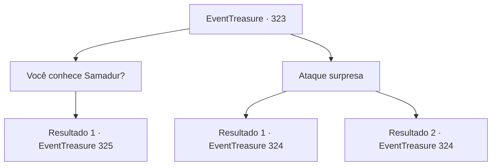

# Eventos de tesouro · 323

[Índice da tabela](index.md) · [Índice geral](../index.md)

ID: `pt:EventTreasure:323` · Fonte: `EventTreasure4` · Versão: 1.2.47.

Mapeamento estático dos arquivos; a disponibilidade e a execução dependem do estado da run.

## Texto do evento

Você chegou a uma região vulcânica desolada em busca do dragão vermelho 'Samadur' que ouviu falar antes. Do alto do vulcão, também conhecido como 'Chifre do Inferno', lava flui com um calor escaldante, e enxofre e vapor irrompem dos gêiseres espalhados ao redor. Você enxuga o suor e continua em frente. E não muito tempo depois, você encontra um gigante de fogo, tomando banho em uma fonte termal. Ele parece ainda não ter notado você.

## Dados de entrada

```json
{
  "id": 323,
  "grade": 2,
  "place": "",
  "required": "5_568_1|1_2_77"
}
```

## Mapa das escolhas



## Escolhas e resultados

### Escolha 1

Você conhece Samadur?

Requisitos e outros campos da escolha:

```json
{
  "required": ""
}
```

#### Resultado 1.1

Você pergunta ao gigante que está desfrutando da fonte termal. Em resposta, ele olha para você de cima e grita. 

 "Eh? O que? Pequeno moleque, veio aqui desejando morrer?"

 O gigante de fogo, conhecido por ter um temperamento ardente de acordo com seu nome, se levanta bruscamente e pega sua espada gigante, como se quisesse demonstrar que isso não é uma exageração.

Continuação registrada: [Evento 325](0325.md) na mesma tabela.

```json
{
  "required": "",
  "chance": "1",
  "nextEvent": 325,
  "type": 2,
  "reward": "5_568_2"
}
```

### Escolha 2

Ataque surpresa

Requisitos e outros campos da escolha:

```json
{
  "required": ""
}
```

#### Resultado 2.1

De repente, você atacou o gigante que estava desfrutando da fonte quente. 

 "¡Aargh..! Maldito moleque!"

 O gigante de fogo, atingido na cabeça pelo seu ataque, cambaleia e se levanta. Em seguida, ele levanta sua espada gigante e a arremessa em sua direção.

Continuação registrada: [Evento 324](0324.md) na mesma tabela.

```json
{
  "required": "",
  "chance": "1|0_6_1",
  "nextEvent": 324,
  "type": 0,
  "reward": "6_2_16|5_568_2",
  "place": 2
}
```

#### Resultado 2.2

De repente, você atacou o gigante que estava desfrutando da fonte quente. No entanto, o gigante, mais rápido do que parece, desvia do seu ataque. 

 "¡Aargh..! Maldito moleque!"

 O gigante de fogo, atingido na cabeça pelo seu ataque, cambaleia e se levanta. Em seguida, ele levanta sua espada gigante e a arremessa em sua direção.

Continuação registrada: [Evento 324](0324.md) na mesma tabela.

```json
{
  "required": "",
  "chance": "14",
  "nextEvent": 324,
  "type": 1,
  "reward": "6_0_16|5_568_2",
  "place": 2
}
```

## Referências que chegam a este evento

Nenhum `nextEvent` positivo da mesma tabela aponta para este nó. Isso não prova que seja inacessível: sorteio e estado de história podem selecioná-lo.

