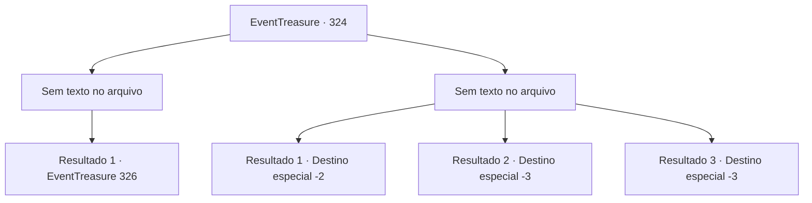

# Eventos de tesouro · 324

[Índice da tabela](index.md) · [Índice geral](../index.md)

ID: `pt:EventTreasure:324` · Fonte: `EventTreasure4` · Versão: 1.2.47.

Mapeamento estático dos arquivos; a disponibilidade e a execução dependem do estado da run.

## Texto do evento

*Sem texto no arquivo.*

## Dados de entrada

```json
{
  "id": 324,
  "grade": 1,
  "place": "",
  "required": ""
}
```

## Mapa das escolhas



## Escolhas e resultados

### Escolha 1

*Sem texto no arquivo; o papel dessa opção depende da interface do jogo.*

Requisitos e outros campos da escolha:

```json
{
  "required": ""
}
```

#### Resultado 1.1

Você está golpeando o gigante de fogo. Sentindo a dor, o gigante de fogo ofega intensamente e te encara fixamente. 

 "Você... quem... é..."

 Você pergunta onde está Samadur. Ele aponta para o vulcão com um movimento brusco do queixo. 

 "...Essa besta vive no topo daquele vulcão, em sua caverna. Não é uma ameaça comum, até mesmo nós, os gigantes, evitamos nos aproximar muito."


Continuação registrada: [Evento 326](0326.md) na mesma tabela.

```json
{
  "required": "",
  "chance": "1",
  "nextEvent": 326,
  "type": 2,
  "reward": ""
}
```

### Escolha 2

*Sem texto no arquivo; o papel dessa opção depende da interface do jogo.*

Requisitos e outros campos da escolha:

```json
{
  "required": ""
}
```

#### Resultado 2.1

Você agarra a cauda do gigante de fogo. Ele te persegue por um tempo, depois aparentemente entediado ou cansado, volta para sua fonte quente.

Continuação registrada: [Destino especial `-2`](../destinos-especiais.md).

```json
{
  "required": "1_0_2|1_1_2",
  "chance": "1",
  "nextEvent": -2,
  "type": 2,
  "reward": "5_568_9|0_0_-1|0_1_-1"
}
```

#### Resultado 2.2

A grande espada do gigante de fogo partiu seu corpo ao meio. Com isso, sua aventura chegou a um final abrupto.

Continuação registrada: [Destino especial `-3`](../destinos-especiais.md).

```json
{
  "required": "2_0_2",
  "chance": "1",
  "nextEvent": -3,
  "type": 2,
  "reward": "0_0_-1|0_1_-1"
}
```

#### Resultado 2.3

A grande espada do gigante de fogo partiu seu corpo ao meio. Com isso, sua aventura chegou a um final abrupto.

Continuação registrada: [Destino especial `-3`](../destinos-especiais.md).

```json
{
  "required": "2_1_2",
  "chance": "1",
  "nextEvent": -3,
  "type": 2,
  "reward": "0_0_-1|0_1_-1"
}
```

## Referências que chegam a este evento

- [Evento 323 · escolha 2 · resultado 1](0323.md#escolha-2)
- [Evento 323 · escolha 2 · resultado 2](0323.md#escolha-2)
- [Evento 325 · escolha 1 · resultado 2](0325.md#escolha-1)
- [Evento 325 · escolha 2 · resultado 1](0325.md#escolha-2)
