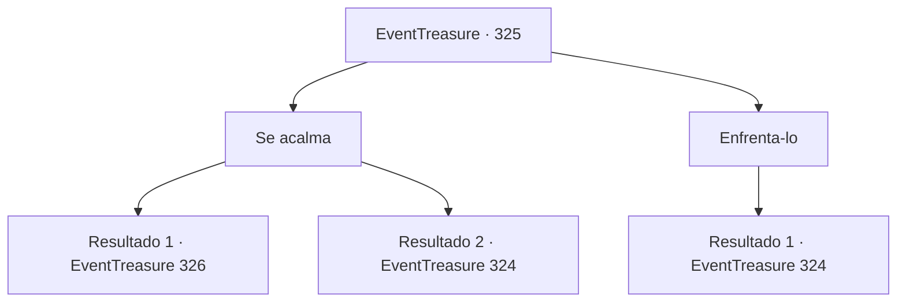

# Eventos de tesouro · 325

[Índice da tabela](index.md) · [Índice geral](../index.md)

ID: `pt:EventTreasure:325` · Fonte: `EventTreasure4` · Versão: 1.2.47.

Mapeamento estático dos arquivos; a disponibilidade e a execução dependem do estado da run.

## Texto do evento

*Sem texto no arquivo.*

## Dados de entrada

```json
{
  "id": 325,
  "grade": 1,
  "place": "",
  "required": ""
}
```

## Mapa das escolhas



## Escolhas e resultados

### Escolha 1

Se acalma

Requisitos e outros campos da escolha:

```json
{
  "required": ""
}
```

#### Resultado 1.1

Você acalmou o gigante e perguntou sobre Samadur. O gigante de fogo aponta para o vulcão e diz, 

 "Aquela besta vive no topo daquele vulcão, em sua caverna. Não é uma ameaça comum, até mesmo nós, gigantes, evitamos nos aproximar muito."


Continuação registrada: [Evento 326](0326.md) na mesma tabela.

```json
{
  "required": "",
  "chance": "1|0_12_1",
  "nextEvent": 326,
  "type": 0,
  "reward": "5_569_1"
}
```

#### Resultado 1.2

Tentaste acalmar o gigante. No entanto, o gigante de fogo se emociona ainda mais e balança sua espada gigante.

Continuação registrada: [Evento 324](0324.md) na mesma tabela.

```json
{
  "required": "",
  "chance": "16",
  "nextEvent": 324,
  "type": 1,
  "reward": "6_0_16",
  "place": 2
}
```

### Escolha 2

Enfrenta-lo

Requisitos e outros campos da escolha:

```json
{
  "required": ""
}
```

#### Resultado 2.1

Você encarou fixamente o gigante de fogo, se preparando para a luta. O gigante, apoiando sua espada gigante no ombro, ruge. 

 "Oh... Então você finalmente decidiu enfrentar-me. Você está fora da sua liga. Com prazer eu te matarei!"


Continuação registrada: [Evento 324](0324.md) na mesma tabela.

```json
{
  "required": "",
  "chance": "1",
  "nextEvent": 324,
  "type": 2,
  "reward": "6_0_16",
  "place": 2
}
```

## Referências que chegam a este evento

- [Evento 323 · escolha 1 · resultado 1](0323.md#escolha-1)
