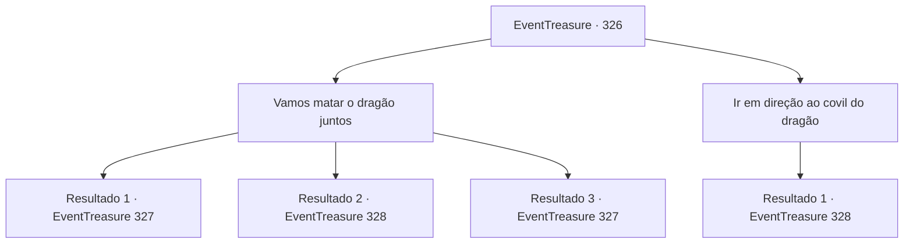

# Eventos de tesouro · 326

[Índice da tabela](index.md) · [Índice geral](../index.md)

ID: `pt:EventTreasure:326` · Fonte: `EventTreasure4` · Versão: 1.2.47.

Mapeamento estático dos arquivos; a disponibilidade e a execução dependem do estado da run.

## Texto do evento

*Sem texto no arquivo.*

## Dados de entrada

```json
{
  "id": 326,
  "grade": 1,
  "place": "",
  "required": ""
}
```

## Mapa das escolhas



## Escolhas e resultados

### Escolha 1

Vamos matar o dragão juntos

Requisitos e outros campos da escolha:

```json
{
  "required": ""
}
```

#### Resultado 1.1

Convenceste o gigante de fogo com uma lógica e eloquência excelentes. O gigante de fogo assentiu enquanto ouvia a tua história. 

 "Hmm... Tens razão. Posso me tornar o governante deste vulcão... Se me livrar desse dragão, é completamente possível. Bem. Siga-me."

 Ele pendurou sua grande espada sobre o ombro e abriu o caminho, e tu seguiste o gigante em direção ao topo do vulcão. Não muito depois, tu e o gigante chegam a uma grande caverna perto do cume. Ar quente sai da caverna. 

 "Vamos para dentro."

 A imensa caverna de pedra está intensamente quente, o calor só aumenta à medida que avanças mais para dentro. Pouco depois, um tremor sacode o chão. Então, da escuridão da caverna, um dragão de escamas vermelhas se revela. |drawing_redDragon| 

 "Grrrrrr..."

 A afirmação de que o dragão vermelho é feroz parece ser verdadeira. Ao ver-te e ao gigante, o dragão imediatamente cospe fogo.

Continuação registrada: [Evento 327](0327.md) na mesma tabela.

```json
{
  "required": "5_569_1",
  "chance": "1|0_7_1",
  "nextEvent": 327,
  "type": 0,
  "reward": "5_570_1"
}
```

#### Resultado 1.2

Tentaste persuadir o Gigante de Fogo para que te ajudasse na batalha contra o dragão. No entanto, ele negou com a cabeça, indicando sua recusa. 

 "Não. Prefiro não fazê-lo. Não tenho vontade de me envolver em uma empreitada tão temerária."

 Ele mergulhou novamente na fonte termal com um longo suspiro. No final, subiste sozinho ao vulcão. Não muito depois, chegas a uma grande caverna perto do topo. Ar quente sai da caverna. A imensa caverna de pedra é intensamente quente, o calor aumenta à medida que te adentras. Pouco depois, um tremor sacode o solo. Então, da escuridão da caverna, revela-se um dragão de escamas vermelhas. |drawing_redDragon| 

 "Grrrrrr..."

 A afirmação de que o dragão vermelho é feroz parece ser verdadeira. Ao te ver, o dragão imediatamente cospe fogo.

Continuação registrada: [Evento 328](0328.md) na mesma tabela.

```json
{
  "required": "5_569_1",
  "chance": "12",
  "nextEvent": 328,
  "type": 1,
  "reward": ""
}
```

#### Resultado 1.3

Colocaste o Gigante de Fogo na linha de frente, dirigindo-se para a toca do dragão. Ele parecia relutante, mas ainda assim cumpriu com suas intenções. Ele pendurou sua grande espada sobre o ombro e liderou o caminho, e você seguiu o gigante subindo o vulcão. Não demorou muito para que você e o gigante chegassem a uma grande caverna perto do topo. Ar quente sai da caverna. 

 "Vamos entrar."

 A imensa caverna de pedra está intensamente quente, o calor só aumenta à medida que você avança mais para dentro. Pouco depois, um tremor sacode o chão. Então, da escuridão da caverna, um dragão de escamas vermelhas se revela. |drawing_redDragon| 

 "Grrrrrr..."

 A afirmação de que o dragão vermelho é feroz parece ser verdadeira. Ao ver você e o gigante, o dragão imediatamente cospe fogo.

Continuação registrada: [Evento 327](0327.md) na mesma tabela.

```json
{
  "required": "18_569_1",
  "chance": "1",
  "nextEvent": 327,
  "type": 2,
  "reward": "5_570_1"
}
```

### Escolha 2

Ir em direção ao covil do dragão

Requisitos e outros campos da escolha:

```json
{
  "required": ""
}
```

#### Resultado 2.1

Você se dirigiu à toca do dragão vermelho. Não muito tempo depois, você chega a uma grande caverna perto do topo. O ar quente sai da caverna. A imensa caverna de pedra está intensamente quente, o calor só aumenta à medida que você se adentra. Pouco depois, um tremor sacode o chão. Então, da escuridão da caverna, revela-se um dragão de escamas vermelhas. |drawing_redDragon| 

 "Grrrrrr..."

 A afirmação de que o dragão vermelho é feroz parece ser verdadeira. Ao te ver, o dragão imediatamente cospe fogo.

Continuação registrada: [Evento 328](0328.md) na mesma tabela.

```json
{
  "required": "",
  "chance": "1",
  "nextEvent": 328,
  "type": 2,
  "reward": ""
}
```

## Referências que chegam a este evento

- [Evento 324 · escolha 1 · resultado 1](0324.md#escolha-1)
- [Evento 325 · escolha 1 · resultado 1](0325.md#escolha-1)
