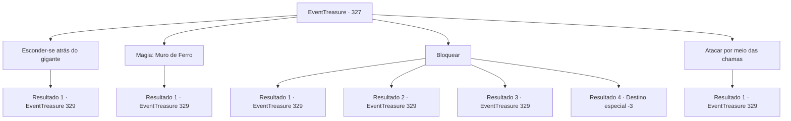

# Eventos de tesouro · 327

[Índice da tabela](index.md) · [Índice geral](../index.md)

ID: `pt:EventTreasure:327` · Fonte: `EventTreasure4` · Versão: 1.2.47.

Mapeamento estático dos arquivos; a disponibilidade e a execução dependem do estado da run.

## Texto do evento

*Sem texto no arquivo.*

## Dados de entrada

```json
{
  "id": 327,
  "grade": 1,
  "place": "",
  "required": ""
}
```

## Mapa das escolhas



## Escolhas e resultados

### Escolha 1

Esconder-se atrás do gigante

Requisitos e outros campos da escolha:

```json
{
  "required": ""
}
```

#### Resultado 1.1

O Gigante de Fogo ergueu sua enorme espada para bloquear o hálito do dragão. Como resultado, a espada começou a brilhar em vermelho vivo e começou a derreter. 

 "Maldição..!"

 O gigante lança sua espada derretida no dragão e avança com os punhos nus. Você também se junta a ele, correndo em direção ao dragão.

Continuação registrada: [Evento 329](0329.md) na mesma tabela.

```json
{
  "required": "",
  "chance": "1",
  "nextEvent": 329,
  "type": 2,
  "reward": "6_0_52",
  "place": 6
}
```

### Escolha 2

Magia: Muro de Ferro

Requisitos e outros campos da escolha:

```json
{
  "required": "20_0_3|1_1_2"
}
```

#### Resultado 2.1

Convocas um resistente muro de aço usando magia. O muro de aço bloqueou a respiração do dragão, mas não conseguiu resistir por muito tempo e derreteu. O dragão vermelho rugiu e atravessou o muro incandescente. <link=shake>

 "Vou assar todos vocês!"

</link> O rugido furioso do dragão sacode toda a caverna. O Gigante de Fogo, desafiante diante disso, avança contra o dragão com sua espada gigante. 

 "Você é quem vai morrer! Urah!"

 Você também se junta a ele, correndo em direção ao dragão.

Continuação registrada: [Evento 329](0329.md) na mesma tabela.

```json
{
  "required": "",
  "chance": "1",
  "nextEvent": 329,
  "type": 2,
  "reward": "6_2_52|0_1_-1",
  "place": 6
}
```

### Escolha 3

Bloquear

Requisitos e outros campos da escolha:

```json
{
  "required": "20_9_2|20_13_1"
}
```

#### Resultado 3.1

Você se apressou para frente e bloqueou o ataque de sopro. O calor escaldante te atingiu e se dispersou. O Gigante de Fogo olhou surpreso e disse. 

 "Você, um simples humano, é bastante formidável..."

 Quando você desvia o sopro, o dragão fica ainda mais agitado e rugiu. <link=shake>

 "Eu vou te destruir!"

</link> O rugido furioso do dragão sacode toda a caverna. O Gigante de Fogo, desafiante diante disso, avança contra o dragão com sua espada gigante. 

 "Você é quem vai morrer! Urah!!"

 Você também se junta a ele, correndo em direção ao dragão.

Continuação registrada: [Evento 329](0329.md) na mesma tabela.

```json
{
  "required": "20_13_3",
  "chance": "1",
  "nextEvent": 329,
  "type": 2,
  "reward": "6_2_52",
  "place": 6
}
```

#### Resultado 3.2

Você se apressou para frente e bloqueou o ataque de bafo. O calor escaldante te envolveu, ameaçando derreter você, mas no final, você resistiu. O Gigante de Fogo olhou surpreso e disse: 

 "Você, um simples humano, é bastante formidável..."

 Quando você desvia o bafo, o dragão fica ainda mais agitado e rugiu. <link=shake>

 "Eu vou te destruir!"

</link> O rugido furioso do dragão sacode toda a caverna. O Gigante de Fogo, desafiante diante disso, avança contra o dragão com sua grande espada. 

 "Você é quem vai morrer! Urah!"

 Você também se junta a ele, correndo em direção ao dragão.

Continuação registrada: [Evento 329](0329.md) na mesma tabela.

```json
{
  "required": "21_13_3",
  "chance": "1|0_13_1",
  "nextEvent": 329,
  "type": 0,
  "reward": "6_2_52",
  "place": 6
}
```

#### Resultado 3.3

Tentaste avançar rapidamente para bloquear a respiração do dragão. No entanto, o calor escaldante te envolveu como se quisesse derreter-te e não conseguiste resistir, escondendo-te atrás do gigante. O Gigante de Fogo ergueu sua enorme espada para bloquear a respiração do dragão. Como resultado, a espada começou a brilhar em vermelho vivo e começou a derreter. 

 "Maldição..!"

 O gigante lança sua espada derretida no dragão e se lança com os punhos nus. Tu também te juntas a ele, correndo em direção ao dragão.

Continuação registrada: [Evento 329](0329.md) na mesma tabela.

```json
{
  "required": "21_13_3|1_0_2",
  "chance": "18",
  "nextEvent": 329,
  "type": 1,
  "reward": "6_0_52|0_0_-1",
  "place": 6
}
```

#### Resultado 3.4

Tentaste avançar rapidamente para bloquear a respiração do dragão. No entanto, o calor escaldante te derrete por completo.

Continuação registrada: [Destino especial `-3`](../destinos-especiais.md).

```json
{
  "required": "21_13_3|2_0_2",
  "chance": "18",
  "nextEvent": -3,
  "type": 1,
  "reward": "0_0_-1"
}
```

### Escolha 4

Atacar por meio das chamas

Requisitos e outros campos da escolha:

```json
{
  "required": "20_13_3"
}
```

#### Resultado 4.1

Você atravessou as chamas do dragão vermelho, avançando rapidamente. O intenso calor dissipou-se ao tocar o seu corpo. Conforme você se aproximava da cabeça do dragão, levantou sua arma e golpeou com força sua língua. 

 "¡Roaaar!"

 Com uma chuva de sangue, parte da língua se desprendeu e o dragão, surpreendido pelo ataque inesperado, rugiu com maior emoção. <link=shake>

 "¡Eu te derrotarei!"

</link> O rugido furioso do dragão sacode toda a caverna. O Gigante de Fogo, desafiante diante disso, investe contra o dragão com sua espada gigante. 

 "¡Você é quem vai morrer! ¡Urah!"

 Você também se junta a ele, correndo em direção ao dragão.

Continuação registrada: [Evento 329](0329.md) na mesma tabela.

```json
{
  "required": "",
  "chance": "1",
  "nextEvent": 329,
  "type": 2,
  "reward": "6_2_52",
  "place": 6
}
```

## Referências que chegam a este evento

- [Evento 326 · escolha 1 · resultado 1](0326.md#escolha-1)
- [Evento 326 · escolha 1 · resultado 3](0326.md#escolha-1)
