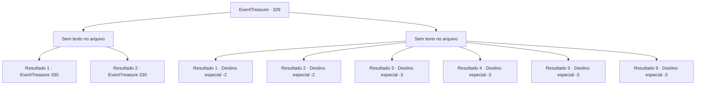

# Eventos de tesouro · 329

[Índice da tabela](index.md) · [Índice geral](../index.md)

ID: `pt:EventTreasure:329` · Fonte: `EventTreasure4` · Versão: 1.2.47.

Mapeamento estático dos arquivos; a disponibilidade e a execução dependem do estado da run.

## Texto do evento

*Sem texto no arquivo.*

## Dados de entrada

```json
{
  "id": 329,
  "grade": 1,
  "place": "",
  "required": ""
}
```

## Mapa das escolhas



## Escolhas e resultados

### Escolha 1

*Sem texto no arquivo; o papel dessa opção depende da interface do jogo.*

Requisitos e outros campos da escolha:

```json
{
  "required": ""
}
```

#### Resultado 1.1

Depois de uma feroz batalha com sangue e chamas voando, você conseguiu derrubar o dragão vermelho. O Gigante de Fogo, rindo, senta-se em cima do cadáver do dragão. 

 "Ha, ha, ha! Dragões não são tão especiais! Eu... eu sou o governante deste vulcão!"

 Ruge triunfantemente, quase tendo conhecido a morte ele mesmo, e então cai em um desmaio. Você pega a garra dianteira direita do dragão vermelho como prova de sua vitória. Em seguida, sem demora, você segue diretamente para a casa de Oliger.

Continuação registrada: [Evento 330](0330.md) na mesma tabela.

```json
{
  "required": "5_570_1",
  "chance": "1",
  "nextEvent": 330,
  "type": 2,
  "reward": ""
}
```

#### Resultado 1.2

Após uma feroz batalha com sangue e chamas voando, você conseguiu derrubar o dragão vermelho. Você pega a garra dianteira direita do dragão vermelho como prova de sua vitória. Em seguida, sem demora, você se dirige diretamente à casa de Oliger.

Continuação registrada: [Evento 330](0330.md) na mesma tabela.

```json
{
  "required": "18_570_1",
  "chance": "1",
  "nextEvent": 330,
  "type": 2,
  "reward": ""
}
```

### Escolha 2

*Sem texto no arquivo; o papel dessa opção depende da interface do jogo.*

Requisitos e outros campos da escolha:

```json
{
  "required": ""
}
```

#### Resultado 2.1

O muro chamado 'Dragão' era incrivelmente alto, e você provou com seu próprio corpo que as palavras de Oliger eram verdadeiras. Após uma batalha feroz, onde sangue e chamas voavam, a cabeça do Gigante de Fogo ficou reduzida a um monte de carvão, e você mal conseguiu escapar da toca do dragão, sangrando profusamente. Com toda a força que consegue reunir, você corre o mais rápido que pode.

Continuação registrada: [Destino especial `-2`](../destinos-especiais.md).

```json
{
  "required": "5_570_1|1_0_2|1_1_2",
  "chance": "1",
  "nextEvent": -2,
  "type": 2,
  "reward": "5_568_9|0_0_-1|0_1_-1"
}
```

#### Resultado 2.2

O muro chamado 'Dragão' era incrivelmente alto, e você provou com seu próprio corpo que as palavras de Oliger eram verdadeiras. Após uma batalha feroz, onde o sangue e as chamas voavam, você mal conseguiu escapar da toca do dragão, sangrando profusamente. Com toda a força que você pode reunir, você corre o mais rápido que pode.

Continuação registrada: [Destino especial `-2`](../destinos-especiais.md).

```json
{
  "required": "18_570_1|1_0_2|1_1_2",
  "chance": "1",
  "nextEvent": -2,
  "type": 2,
  "reward": "5_568_9|0_0_-1|0_1_-1"
}
```

#### Resultado 2.3

O muro chamado 'Dragão' era incrivelmente alto, e você provou com seu próprio corpo que as palavras de Oliger eram verdadeiras. Após uma batalha feroz, onde sangue e chamas voavam, a cabeça do Gigante de Fogo ficou reduzida a um monte de carvão, E agora é a sua vez. O sopro expelido com o rugido de Samadur instantaneamente transforma você em um monte de cinzas.

Continuação registrada: [Destino especial `-3`](../destinos-especiais.md).

```json
{
  "required": "5_570_1|2_0_2",
  "chance": "1",
  "nextEvent": -3,
  "type": 2,
  "reward": "0_0_-1|0_1_-1"
}
```

#### Resultado 2.4

O muro chamado 'Dragão' era incrivelmente alto, e você provou com seu próprio corpo que as palavras de Oliger eram verdadeiras. Após uma batalha feroz, onde sangue e chamas voavam, a cabeça do Gigante de Fogo ficou reduzida a um monte de carvão, E agora é a sua vez. O sopro expelido com o rugido de Samadur instantaneamente transforma você em um monte de cinzas.

Continuação registrada: [Destino especial `-3`](../destinos-especiais.md).

```json
{
  "required": "5_570_1|2_1_2",
  "chance": "1",
  "nextEvent": -3,
  "type": 2,
  "reward": "0_0_-1|0_1_-1"
}
```

#### Resultado 2.5

O muro chamado 'Dragão' era incrivelmente alto, e você provou com seu próprio corpo que as palavras de Oliger eram verdadeiras. O sopro expelido com o rugido de Samadur te transforma instantaneamente em um monte de cinzas.

Continuação registrada: [Destino especial `-3`](../destinos-especiais.md).

```json
{
  "required": "18_570_1|2_0_2",
  "chance": "1",
  "nextEvent": -3,
  "type": 2,
  "reward": "0_0_-1|0_1_-1"
}
```

#### Resultado 2.6

O muro chamado 'Dragão' era incrivelmente alto, e você provou com seu próprio corpo que as palavras de Oliger eram verdadeiras. O sopro expelido com o rugido de Samadur te transforma instantaneamente em um monte de cinzas.

Continuação registrada: [Destino especial `-3`](../destinos-especiais.md).

```json
{
  "required": "18_570_1|2_1_2",
  "chance": "1",
  "nextEvent": -3,
  "type": 2,
  "reward": "0_0_-1|0_1_-1"
}
```

## Referências que chegam a este evento

- [Evento 327 · escolha 1 · resultado 1](0327.md#escolha-1)
- [Evento 327 · escolha 2 · resultado 1](0327.md#escolha-2)
- [Evento 327 · escolha 3 · resultado 1](0327.md#escolha-3)
- [Evento 327 · escolha 3 · resultado 2](0327.md#escolha-3)
- [Evento 327 · escolha 3 · resultado 3](0327.md#escolha-3)
- [Evento 327 · escolha 4 · resultado 1](0327.md#escolha-4)
- [Evento 328 · escolha 1 · resultado 1](0328.md#escolha-1)
- [Evento 328 · escolha 2 · resultado 1](0328.md#escolha-2)
- [Evento 328 · escolha 2 · resultado 2](0328.md#escolha-2)
- [Evento 328 · escolha 2 · resultado 3](0328.md#escolha-2)
- [Evento 328 · escolha 3 · resultado 1](0328.md#escolha-3)
- [Evento 328 · escolha 3 · resultado 2](0328.md#escolha-3)
- [Evento 328 · escolha 4 · resultado 1](0328.md#escolha-4)
