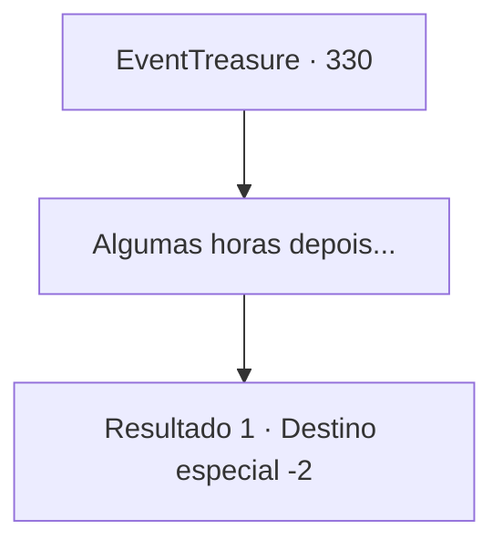

# Eventos de tesouro · 330

[Índice da tabela](index.md) · [Índice geral](../index.md)

ID: `pt:EventTreasure:330` · Fonte: `EventTreasure4` · Versão: 1.2.47.

Mapeamento estático dos arquivos; a disponibilidade e a execução dependem do estado da run.

## Texto do evento

*Sem texto no arquivo.*

## Dados de entrada

```json
{
  "id": 330,
  "grade": 1,
  "place": "",
  "required": ""
}
```

## Mapa das escolhas



## Escolhas e resultados

### Escolha 1

Algumas horas depois...

Requisitos e outros campos da escolha:

```json
{
  "required": ""
}
```

#### Resultado 1.1

Você chegou à casa de Oliger. Ele estava arrancando ervas daninhas em seu campo. Você estende a pata dianteira do dragão para Oliger. Ele leva um momento para olhar para ela, então seus olhos se abrem de surpresa. 

 "Oh... meu Deus!"

 Ele a examina de um lado para o outro, seus olhos se abrem ainda mais. Então, como se não pudesse acreditar, exclama, 

 "Você realmente... a derrotou? Oh meu Deus... oh meu Deus... Obrigado. Estou realmente grato."

 Como um gesto de gratidão, ele lhe entrega a espada que usava quando estava em aventuras. Você entrega a pata dianteira de Samadur e aceita sua espada. 

 "Cuide-se. Bênçãos em sua jornada."

 Oliger expressa repetidamente sua gratidão, e você troca cumprimentos com ele depois de pegar a espada.

Continuação registrada: [Destino especial `-2`](../destinos-especiais.md).

```json
{
  "required": "",
  "chance": "1",
  "nextEvent": -2,
  "type": 2,
  "reward": "5_568_9|27_41_1|3_66_1"
}
```

## Referências que chegam a este evento

- [Evento 329 · escolha 1 · resultado 1](0329.md#escolha-1)
- [Evento 329 · escolha 1 · resultado 2](0329.md#escolha-1)
