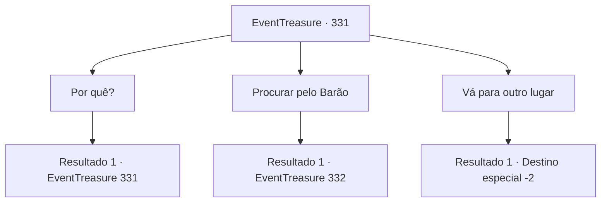

# Eventos de tesouro · 331

[Índice da tabela](index.md) · [Índice geral](../index.md)

ID: `pt:EventTreasure:331` · Fonte: `EventTreasure4` · Versão: 1.2.47.

Mapeamento estático dos arquivos; a disponibilidade e a execução dependem do estado da run.

## Texto do evento

Você fez uma parada em uma cidade chamada 'Roca Flotante'. Este lugar é famoso por suas vastas pedreiras de mármore, e ainda mais pelas canais e gôndolas que cruzam a cidade. Enquanto você passeia pela cidade, avista um aviso em um quadro de avisos em um canto da praça, escrito em uma caligrafia fluida. 

 'Se você confia na sua sorte em apostas, procure-me, 'Barão Langston.' 

 Enquanto você olha para o aviso, um homem idoso em roupas simples se aproxima e fala. 

 "Você parece um aventureiro... Se está considerando desafiar o Barão Langston, eu aconselharia a reconsiderar."


## Dados de entrada

```json
{
  "id": 331,
  "grade": 2,
  "place": "",
  "required": "1_2_30|5_559_0|26_18_1"
}
```

## Mapa das escolhas



## Escolhas e resultados

### Escolha 1

Por quê?

Requisitos e outros campos da escolha:

```json
{
  "required": "5_560_0"
}
```

#### Resultado 1.1

Você pergunta ao ancião pelo motivo. Ele dá uma rápida olhada ao redor antes de continuar falando. 

 "Alguns apostaram com o barão, perderam todo o seu dinheiro, ou até mesmo caíram em dívidas e se tornaram escravos. Ele parece ser bastante habilidoso em explorar os outros. Por isso, ele é incrivelmente arrogante. Se alguém simplesmente o colocasse em seu lugar..."

 O ancião fica em silêncio no final.

Continuação registrada: [Evento 331](0331.md) na mesma tabela.

```json
{
  "required": "",
  "chance": "1",
  "nextEvent": 331,
  "type": 2,
  "reward": "5_560_1"
}
```

### Escolha 2

Procurar pelo Barão

Requisitos e outros campos da escolha:

```json
{
  "required": ""
}
```

#### Resultado 2.1

Visite a sala de jogos onde o Barão Langston aparece todos os dias. Já vitorioso contra alguém, o barão está bebendo ruidosamente uísque e gritando para os espectadores ao seu redor. 

 "Ha-ha! Você não é rival para mim! O quê? Pronto para outro jogo? Hein?"

 O homem sentado em frente ao barão se levanta de sua cadeira, cambaleando, passa por você e se dirige para a saída do bar. O olhar do barão segue o homem antes de se fixar em você. 

 "Ah, um novo desafiante?"

 Ele se inclina para trás e cruza as pernas. Nessa postura presunçosa, ele pergunta. 

 "Você gostaria de jogar um jogo comigo? A aposta é de 50 moedas de ouro."

 O jogo que ele propõe envolve colocar dois dados de seis faces em um copo e lançá-los, a pessoa com a soma mais alta dos dois números ganha. 

 "Antes de revelar os dados, cada jogador pode verificar os seus, e decidir se aumentar a aposta ou desistir do jogo."


Continuação registrada: [Evento 332](0332.md) na mesma tabela.

```json
{
  "required": "",
  "chance": "1",
  "nextEvent": 332,
  "type": 2,
  "reward": ""
}
```

### Escolha 3

Vá para outro lugar

Requisitos e outros campos da escolha:

```json
{
  "required": ""
}
```

#### Resultado 3.1

Decide não procurar a Baron Langston, seguindo o conselho do ancião.

Continuação registrada: [Destino especial `-2`](../destinos-especiais.md).

```json
{
  "required": "",
  "chance": "1",
  "nextEvent": -2,
  "type": 2,
  "reward": "5_559_9"
}
```

## Referências que chegam a este evento

- [Evento 331 · escolha 1 · resultado 1](0331.md#escolha-1)
