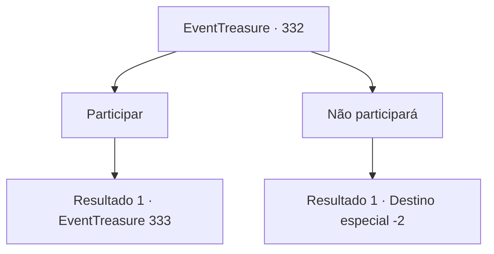

# Eventos de tesouro · 332

[Índice da tabela](index.md) · [Índice geral](../index.md)

ID: `pt:EventTreasure:332` · Fonte: `EventTreasure4` · Versão: 1.2.47.

Mapeamento estático dos arquivos; a disponibilidade e a execução dependem do estado da run.

## Texto do evento

*Sem texto no arquivo.*

## Dados de entrada

```json
{
  "id": 332,
  "grade": 1,
  "place": "",
  "required": ""
}
```

## Mapa das escolhas



## Escolhas e resultados

### Escolha 1

Participar

Requisitos e outros campos da escolha:

```json
{
  "required": "1_4_50"
}
```

#### Resultado 1.1

Você faz sua aposta e se senta em frente ao Barão. O Barão Langston acaricia seu bigode encaracolado, examinando você. 

 "Parece ser um aventureiro... mas não dou sorte para principiantes."

 Enquanto isso, o crupiê coloca dois dados em um copo, os sacode e os despeja sobre a mesa. E empurra um na sua frente e o outro na frente do Barão. 

 "Agora, por favor, verifique seus dados para que a outra pessoa não possa vê-los."

 Seguindo as palavras do crupiê, você levanta levemente o copo para verificar os dados. Seus dados são 1 e 2.

Continuação registrada: [Evento 333](0333.md) na mesma tabela.

```json
{
  "required": "",
  "chance": "1",
  "nextEvent": 333,
  "type": 2,
  "reward": "0_4_-50"
}
```

### Escolha 2

Não participará

Requisitos e outros campos da escolha:

```json
{
  "required": ""
}
```

#### Resultado 2.1

Quando você declara que não vai participar, Barão Langston fala como se estivesse um pouco decepcionado. 

 "Será que realmente não há ninguém que me desafie...?"

 De qualquer forma, você sai da sala de apostas.

Continuação registrada: [Destino especial `-2`](../destinos-especiais.md).

```json
{
  "required": "",
  "chance": "1",
  "nextEvent": -2,
  "type": 2,
  "reward": "5_559_9"
}
```

## Referências que chegam a este evento

- [Evento 331 · escolha 2 · resultado 1](0331.md#escolha-2)
