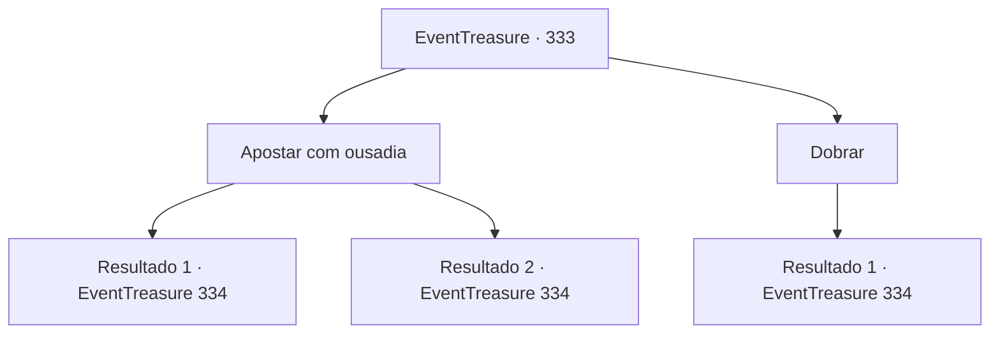

# Eventos de tesouro · 333

[Índice da tabela](index.md) · [Índice geral](../index.md)

ID: `pt:EventTreasure:333` · Fonte: `EventTreasure4` · Versão: 1.2.47.

Mapeamento estático dos arquivos; a disponibilidade e a execução dependem do estado da run.

## Texto do evento

*Sem texto no arquivo.*

## Dados de entrada

```json
{
  "id": 333,
  "grade": 1,
  "place": "",
  "required": ""
}
```

## Mapa das escolhas



## Escolhas e resultados

### Escolha 1

Apostar com ousadia

Requisitos e outros campos da escolha:

```json
{
  "required": "1_4_50"
}
```

#### Resultado 1.1

O Barão encolhe-se e resmunga audaciosamente um 'aumento', e se reclina em sua cadeira. Depois de um momento de consideração, ele decide se retirar desta rodada. Assim, os dados são revelados, e os dados do Barão são 2 e 5. Ele olha para os seus dados e resmunga novamente. 

 "Hmm... Você é bastante bom. Tudo bem. O próximo jogo é por 100 moedas de ouro."


Continuação registrada: [Evento 334](0334.md) na mesma tabela.

```json
{
  "required": "",
  "chance": "1|0_14_1|0_12_1",
  "nextEvent": 334,
  "type": 0,
  "reward": "0_4_100"
}
```

#### Resultado 1.2

Você se declara audaciosamente um 'aumento', e o Barão olha para o seu rosto e sorri como se tivesse descoberto algo. 

 "O que será, Barão?"

 Quando o crupiê pergunta, o Barão decide igualar. Assim, os dados são revelados, e os dados do Barão são 2 e 5. Ele sorri para os seus dados e diz, 

 "Enganando por nada, haha! Tudo bem! O próximo jogo é por 100 moedas de ouro. O que você acha?"


Continuação registrada: [Evento 334](0334.md) na mesma tabela.

```json
{
  "required": "",
  "chance": "24",
  "nextEvent": 334,
  "type": 1,
  "reward": "0_4_-50|5_561_1"
}
```

### Escolha 2

Dobrar

Requisitos e outros campos da escolha:

```json
{
  "required": ""
}
```

#### Resultado 2.1

Decidiste se retirar desta rodada. Assim, os dados são revelados, e os dados do Barão são 2 e 5. Ele sorri para os seus dados e diz, 

 "Oh, você teve má sorte. Tudo bem. O que acha do próximo jogo por 100 moedas de ouro?"


Continuação registrada: [Evento 334](0334.md) na mesma tabela.

```json
{
  "required": "",
  "chance": "1",
  "nextEvent": 334,
  "type": 2,
  "reward": "5_561_1"
}
```

## Referências que chegam a este evento

- [Evento 332 · escolha 1 · resultado 1](0332.md#escolha-1)
