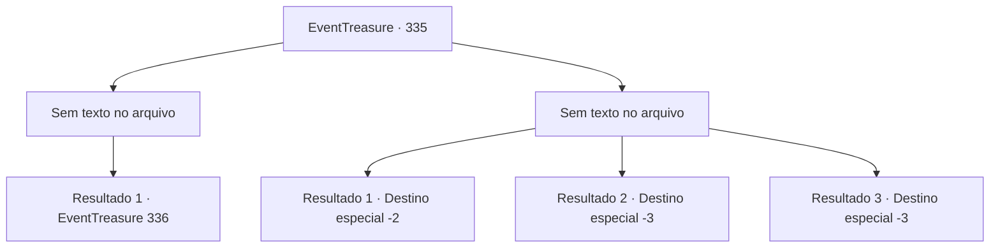

# Eventos de tesouro · 335

[Índice da tabela](index.md) · [Índice geral](../index.md)

ID: `pt:EventTreasure:335` · Fonte: `EventTreasure4` · Versão: 1.2.47.

Mapeamento estático dos arquivos; a disponibilidade e a execução dependem do estado da run.

## Texto do evento

*Sem texto no arquivo.*

## Dados de entrada

```json
{
  "id": 335,
  "grade": 1,
  "place": "",
  "required": ""
}
```

## Mapa das escolhas



## Escolhas e resultados

### Escolha 1

*Sem texto no arquivo; o papel dessa opção depende da interface do jogo.*

Requisitos e outros campos da escolha:

```json
{
  "required": ""
}
```

#### Resultado 1.1

Você mostrou sua força ao Barão de uma maneira ligeiramente diferente do planejado inicialmente. Depois de derrubar o capanga do Barão, você o arrasta para o cassino e o joga na frente do Barão. O Barão abre os olhos, então recua lentamente, gritando. 

 "Você... ousa...! Você não sabe quem eu sou? Acha que pode sair impune com isso?"


Continuação registrada: [Evento 336](0336.md) na mesma tabela.

```json
{
  "required": "",
  "chance": "1",
  "nextEvent": 336,
  "type": 2,
  "reward": ""
}
```

### Escolha 2

*Sem texto no arquivo; o papel dessa opção depende da interface do jogo.*

Requisitos e outros campos da escolha:

```json
{
  "required": ""
}
```

#### Resultado 2.1

Conseguiste escapar dos capangas do barão, zigzagueando pelo labirinto de becos da cidade. Eles te perseguiram por um tempo, mas eventualmente perderam seu rastro. Você navega pelos estreitos e sombrios becos e consegue sair da cidade.

Continuação registrada: [Destino especial `-2`](../destinos-especiais.md).

```json
{
  "required": "1_0_2|1_1_2",
  "chance": "1",
  "nextEvent": -2,
  "type": 2,
  "reward": "5_559_9|0_0_-1|0_1_-1"
}
```

#### Resultado 2.2

A maça do capanga do barão atingiu sua cabeça, destruindo sua consciência. Você desabou em frente à casa de apostas, perdendo a consciência.

Continuação registrada: [Destino especial `-3`](../destinos-especiais.md).

```json
{
  "required": "2_0_2",
  "chance": "1",
  "nextEvent": -3,
  "type": 2,
  "reward": "0_0_-1|0_1_-1"
}
```

#### Resultado 2.3

A maça do capanga do barão atingiu sua cabeça, destruindo sua consciência. Você desabou em frente à casa de apostas, perdendo a consciência.

Continuação registrada: [Destino especial `-3`](../destinos-especiais.md).

```json
{
  "required": "2_1_2",
  "chance": "1",
  "nextEvent": -3,
  "type": 2,
  "reward": "0_0_-1|0_1_-1"
}
```

## Referências que chegam a este evento

- [Evento 334 · escolha 2 · resultado 2](0334.md#escolha-2)
- [Evento 339 · escolha 3 · resultado 2](0339.md#escolha-3)
